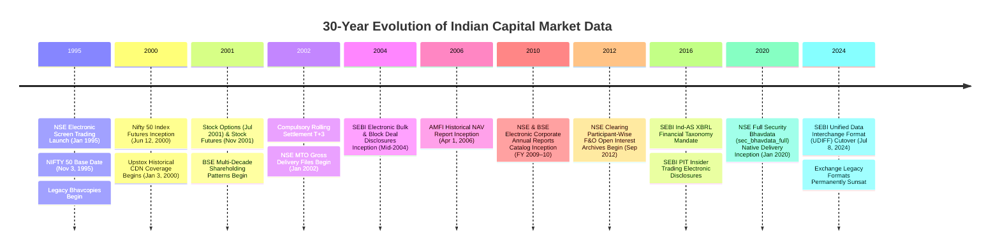

# bfinance-datalake Documentation Master Index

Welcome to the comprehensive technical documentation for **`bfinance-datalake`** — an open-source, point-in-time (PIT) historical and daily data lake engineered for Indian capital markets across equities, derivatives, indices, fundamentals, corporate actions, mutual funds, and institutional flows.

Every feed in this repository has been rigorously verified via empirical live network probes against official exchange endpoints, public CDNs, and statutory regulators.

---

## 1. Documentation Catalog

| Document | Primary Datasets Covered | Source Authorities | Protocol / Format | Temporal Boundary | Update Frequency |
| :--- | :--- | :--- | :--- | :---: | :---: |
| [**Upstox V2 Historical Candle CDN**](upstox_data_integration.md) | NSE & BSE Cash Equities (Pre-2016 Cloud Seeding), Sectoral & Major Indices | Upstox Public CDN | Unauthenticated HTTP JSON | **`2000-01-03` to Present** | On-demand Historical Seeding |
| [**Equity EOD Integration**](equity_eod_data_integration.md) | NSE & BSE Cash Equities: Modern UDIFF, Full Bhavdata, Legacy Bhavcopies, MTO Gross Delivery, Pre-2016 Symbol Fallback | NSE Archives, BSE Downloads, NSE HistoricalOR | HTTPS Zip/CSV, Fixed Width DAT | **`1995-01-03` to Present** | Daily EOD (~18:30 IST) |
| [**Derivatives F&O Integration**](derivatives_fo_data_integration.md) | NSE & BSE Equity Derivatives: Index/Stock Futures (`FUTIDX`, `FUTSTK`), Index/Stock Options Chains (`OPTIDX`, `OPTSTK`), Strikes, Expiries, Settle Price, OI, Change in OI | NSE Archives, BSE Downloads | HTTPS Zip/CSV (UDIFF + Legacy) | **`2000-06-12` to Present** | Daily EOD (~19:00 IST) |
| [**Nifty Indices Integration**](indices_data_integration.md) | 30Y Continuous OHLC, Total Return Index (TRI), Valuation Ratios (P/E, P/B, Div Yield), Daily All-Indices Snapshot (120+ Indices) | NiftyIndices (Sitefinity MVC API), NSE Archives, NSE HistoricalOR | HTTPS POST JSON, CSV | **`1995-11-03` to Present** | Daily EOD (~19:30 IST) |
| [**Universe & Corporate Actions**](universe_and_actions_data_integration.md) | NSE & BSE Security Masters, 1,078 Symbol Rename DAG, PIT Nifty 50 Constituents, 30Y Regex Action Parser, Multiplicative Backward Adjustment | NSE Archives, BSE India, Upstox | Parquet, CSV, Regex Engine | **`1995-01-01` to Present** | Weekly / Daily EOD |
| [**XBRL Fundamentals & Shareholding**](xbrl_fundamentals_and_shareholding_data_integration.md) | Ind-AS XBRL Balance Sheet, P&L, Cash Flow, Banking Metrics, 25-Year BSE Multi-Decade Shareholding, Promoter Pledge, >1% Institutional Holders | NSE Corporates API, BSE Corp Shareholding NG | XML (in-bse-fin, in-bse-bank, in-bse-shp), JSON fallback | **`2001-06-30` to Present** | Quarterly & Annual Disclosures |
| [**Corporate Annual Reports**](annual_reports_integration.md) | 17–18 Continuous Fiscal Years of Official Annual Reports (PDF / ZIP Direct Catalog) | NSE Annual Reports API, BSE AnnualReport/w | HTTPS JSON to Raw PDF Links | **`FY 2009–10` to Present** | Annual / Real-time Filings |
| [**Funds & Institutional Flows**](funds_and_flows_data_integration.md) | AMFI Mutual Fund NAVs (14,400+ Active Schemes, Multi-Mirror Failover, mfapi.in Fallback), NSE F&O Participant Open Interest (`Client`, `DII`, `FII`, `Pro`) | AMFI Portal, MFapi.in, NSE Clearing (NSCCL) | Semicolon Flat Text (Windows-1252), CSV | **`2006-04-01` (AMFI) / `2012-09-03` (Participant OI)** | Daily NAVs (~21:30 IST) / Daily EOD (~20:00 IST) |
| [**Deals, Insider Trading & Market Activity**](deals_insider_and_market_activity.md) | NSE & BSE Bulk & Block Deals, Cash Market Provisional FII / DII Daily Flows (₹ Crores), SEBI PIT Insider Trading Disclosures (Reg 7(2)) | NSE Archives, NSE Corporates API | HTTPS CSV (UTF-8 BOM), JSON | **`2004-01-01` (Deals) / `2016-01-01` (PIT)** | Daily EOD (~18:00 IST) / Real-time Disclosures |
| [**Unified Query Engine**](unified_query_engine.md) | `UnifiedLakeEngine`: Universal crosswalk resolution (`RELIANCE` == `500325` == `INE002A01018`), PyArrow row-group pushdown, DuckDB zero-copy SQL interface | In-Memory Parquet Engine, DuckDB | Python API, DuckDB SQL | **Full Lake Coverage** | Sub-millisecond In-Memory Queries |
| [**Smart Cloud Delta Sync & Releases**](cloud_sync_and_releases.md) | 3-stage architecture: GitHub Actions daily delta builds, SHA-256 `manifest.json` indexing, and ~1.5s local incremental pull via `datalake pull` | GitHub Actions, GitHub Releases | HTTPS JSON Manifest + Parquet Asset Downloads | **`1995` to Present** | Daily at 7:15 PM & 10:00 PM IST |
| [**Zero-Disk Remote Querying**](zero_disk_remote_querying.md) | `RemoteLakeClient`: Direct HTTPS queries over GitHub Releases via DuckDB `httpfs` byte-range requests with 0 MB downloaded to disk | DuckDB `httpfs`, GitHub Releases | Remote Parquet Byte-Range Queries | **Full Lake Coverage** | ~300–550 ms Zero-Disk Remote Queries |

---

## 2. Multi-Decade Historical Boundaries Summary

Indian financial markets have transitioned across multiple technological and regulatory eras over the last 30 years. The table below outlines the exact temporal boundaries and regulatory cutovers verified by our empirical probes:

---

## 3. Resilience, Network & Anti-Bot Infrastructure

To download multi-decade historical archives and real-time feeds reliably without being blocked by exchange firewalls or hitting OS-level socket limitations, `bfinance-datalake` implements:

1. **Universal TLS Fingerprint Impersonation**:
   - Powered by `curl_cffi` impersonating **Chrome 124**.
   - Bypasses Akamai and Cloudflare JA3/JA4 fingerprinting rules on `www.nseindia.com`, `bseindia.com`, `niftyindices.com`, and `amfiindia.com`.
2. **Automated Host Priming**:
   - Automatically visits exchange homepages (`_prime_host`) to acquire required session cookies (`_abck`, `ak_bmsc`, `AKA_A2`, `bm_sz`) before dispatching API calls.
3. **DNS-over-HTTPS (DoH)**:
   - Uses `doh_url="https://dns.google/dns-query"` to circumvent Windows `c-ares` UDP socket timeouts and IPv6 DNS latency.
4. **Encoding Fallbacks**:
   - Dual UTF-8 and Windows-1252 (`cp1252`) decoding to handle typographical symbols and accents in AMFI flat files and legacy BSE records.
5. **Atomic Storage & File Lock Protection**:
   - Unique temporary file generation (`.{uuid}.tmp`) with exponential retry loops and explicit garbage collection (`gc.collect()`) to prevent Windows OS `PermissionError` file-locking deadlocks during Parquet partition upserts.

---

## 4. License & Statutory Notice

`bfinance-datalake` is licensed under the **GNU Affero General Public License v3.0 or later** (`AGPL-3.0-or-later`).  
See [`LICENSE`](../LICENSE) and [`NOTICE`](../NOTICE) for full terms.

Pursuant to Section 7(b) of the GNU AGPLv3, all redistributions must preserve the 4-point **Legal Disclaimer, Data Ownership & Provenance, and SEBI Compliance Notice** intact.
