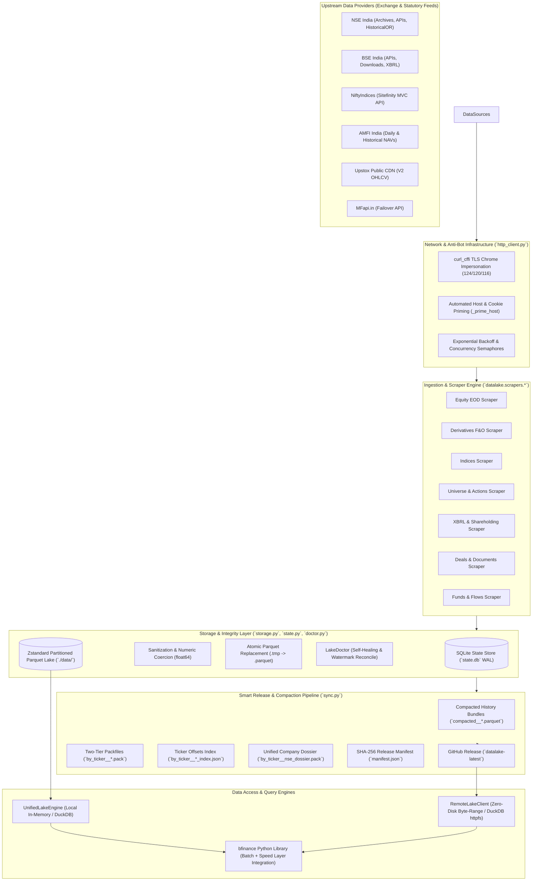
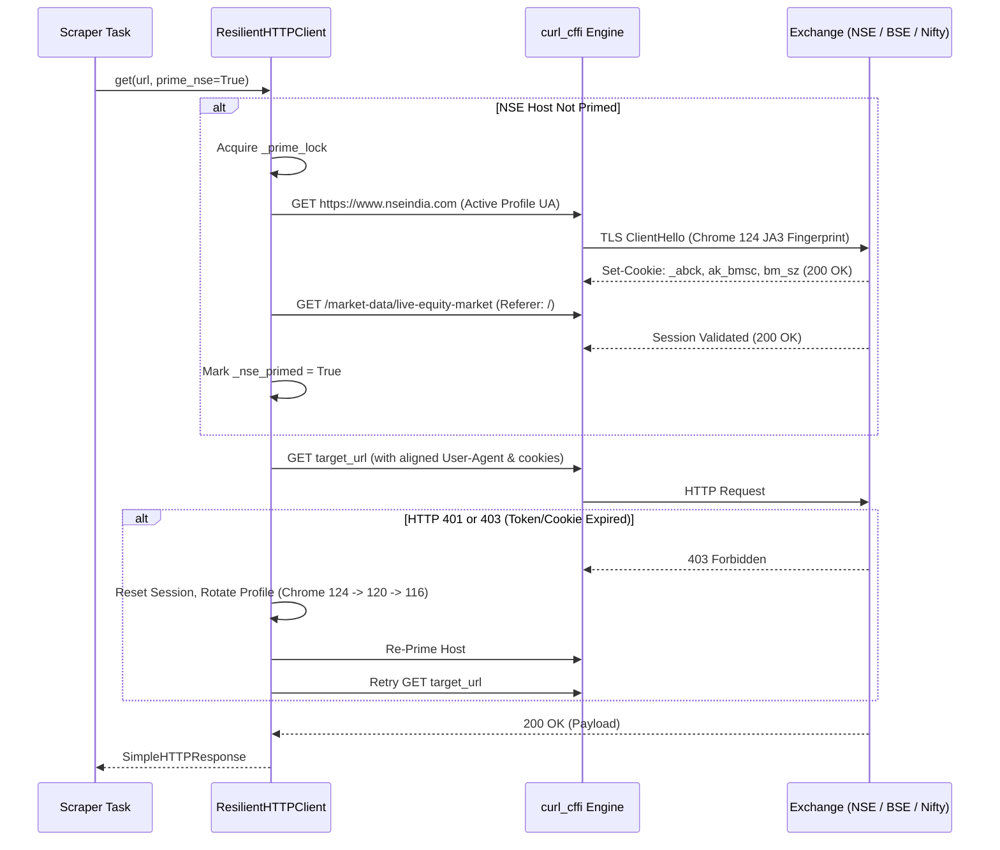
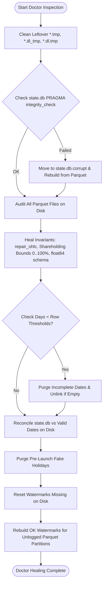
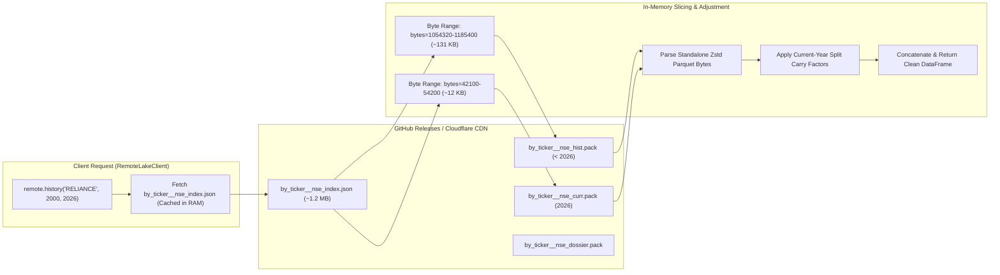

# bfinance-datalake: Architecture & System Design

This document provides a deep, comprehensive architectural specification of **`bfinance-datalake`**. It details the structural design, data flow pipelines, storage invariants, network resilience layer, self-healing doctor engine, and the two-tier remote query protocol.

---

## 1. High-Level System Architecture

`bfinance-datalake` is designed as an automated, point-in-time (PIT) historical batch data lake and daily End-of-Day (EOD) ingestion engine for Indian financial markets. It operates across 15 core datasets spanning cash equities, derivatives (F&O), indices, Ind-AS XBRL fundamentals, corporate actions, shareholding patterns, deals, institutional flows, and mutual funds.



---

## 2. Speed Layer vs. Batch Layer Architecture

`bfinance-datalake` operates in tandem with [`esconer/bfinance`](https://github.com/esconer/bfinance) implementing a classic Lambda/Kappa-hybrid architectural separation:

1. **The Historical Batch Layer (`bfinance-datalake`)**:
   - Contains immutable and finalized historical records from **January 1994** up to **Yesterday's market close**.
   - Stored in column-oriented, Zstandard-compressed Parquet partitions partitioned by year (e.g., `nse_cm_2024.parquet`, `nse_fo_2026.parquet`).
   - Queryable locally in 1–5 ms via PyArrow row-group pushdown or remotely in ~120–350 ms via zero-disk byte-range streaming.
2. **The Real-Time Speed Layer (`bfinance`)**:
   - Handles live trading hours (09:15 to 15:30 IST).
   - Scrapes real-time Current Market Price (CMP), market depth, and intraday minute bars (1m, 5m, 15m, 1h).
3. **The Live Tail Stitcher**:
   - When a user requests historical prices for today, the engine reads 30 years of adjusted historical data from `bfinance-datalake` and appends today's unclosed real-time candle from `bfinance`.
   - This eliminates 95%+ of upstream exchange API rate-limiting calls while maintaining sub-second currency.

---

## 3. Storage Layer & Parquet Invariants

The storage subsystem (`datalake.storage`) guarantees data integrity, cross-platform compatibility, and optimal analytical query performance through strict invariants.

### 3.1. Directory Hierarchy
The data lake root directory (`./data/` or `$BFINANCE_LAKE_DIR`) is organized into domain-specific subdirectories:

| Directory | Contents & Partitioning Pattern | Description |
| :--- | :--- | :--- |
| `universe/` | `nse_equity_master.parquet`, `bse_scrip_master.parquet`, `nse_symbol_changes.parquet`, `nifty_constituents_pit.parquet`, `nse_etf_master.parquet`, `nse_sme_master.parquet`, `nse_delisted_master.parquet` | Security masters, ISIN crosswalks, PIT index constituent snapshots, and ticker rename DAG edges. |
| `equities/` | `nse_cm_YYYY.parquet`, `bse_cm_YYYY.parquet` | Daily cash equity OHLCV, Trades, Turnover, Gross Delivery, and ISIN codes partitioned annually. |
| `derivatives/` | `nse_fo_YYYY.parquet`, `bse_fo_YYYY.parquet`, `fo_ban_list.parquet` | Daily Futures & Option Chains with strike grids, settlement prices, open interest, and daily F&O ban lists. |
| `indices/` | `nifty_30y_ohlc_tri_pe.parquet`, `ind_close_all_YYYY.parquet` | 30-year continuous master for major indices (OHLC, TRI, P/E, P/B, DivYield) and daily market-wide 120+ index snapshots. |
| `actions/` | `nse_corporate_actions.parquet`, `bse_corporate_actions.parquet`, `upcoming_board_meetings.parquet` | Regex-parsed dividends, bonuses, splits, rights, and upcoming earnings board meetings. |
| `fundamentals/` | `xbrl_financials.parquet` | Ind-AS XBRL quarterly and annual balance sheets, P&L statements, and cash flows in ₹ Crores. |
| `shareholding/` | `nse_shareholding_summary.parquet`, `bse_shareholding_history.parquet`, `named_shareholders.parquet` | Multi-decade promoter, FPI, MF, retail percentages, promoter pledge, and >1% institutional holders. |
| `mutual_funds/` | `amfi_nav_YYYY.parquet` | Daily historical Net Asset Values (NAVs) across 14,400+ AMFI schemes. |
| `flows/` | `cash_fii_dii_flows.parquet`, `fao_participant_oi_YYYY.parquet` | Daily provisional cash market FII/DII net flows and NSCCL F&O participant open interest breakdown. |
| `deals/` | `bulk_block_deals.parquet`, `insider_trading_pit.parquet` | SEBI Bulk/Block transactions (2004+) and SEBI PIT Regulation 7(2) insider trades. |
| `documents/` | `annual_reports.parquet`, `concalls_and_filings.parquet` | 20-year annual report PDF catalog and BSE concall transcripts, presentations, and audio recordings. |
| `snapshots/` | `market_screener_latest.parquet` | Pre-computed cross-sectional screener joining latest prices, TTM fundamentals, and shareholding. |

### 3.2. Data Sanitization & Numeric Coercion
PyArrow throws serialization errors if a column contains mixed types (e.g., strings and floats) or if nulls are improperly typed. The function `sanitize_for_parquet(df)` enforces:
1. **Deduplication of Columns**: Any duplicate column names resulting from upstream joins are pruned, retaining the first occurrence.
2. **Numeric Strictness**: All numeric columns defined in `NUMERIC_FLOAT_COLS` (and any column ending in `_Cr`, `_Rs`, or `_Pct`) are coerced via `_coerce_numeric_series()` to `float64`, stripping commas and whitespace. Non-numeric strings or invalid tokens (`-`, `NA`, `null`) become `np.nan`.
3. **String Cleanliness**: Object and string columns are sanitized via `_clean_object_value()` so that bytes, bytearrays, or invalid objects are decoded safely as UTF-8 or mapped to `None`.
4. **Multiplier Defaults**: For `ShareMultiplier`, missing or invalid values default to `1.0` rather than `NaN`.

### 3.3. Atomic Writes on Windows & Unix
On Windows, replacing an open file or writing directly to an active file locks the OS file handle and raises `PermissionError`. To prevent data corruption or partial writes during crashes, `write_parquet_atomic(df, target_path)`:
1. Writes the data to an isolated temporary file: `target_path.with_name(f"{target_path.stem}.{uuid.uuid4().hex[:8]}.tmp")`.
2. Employs Zstandard compression (`compression="zstd"`), page indexes (`write_page_index=True`), and 64 KB data page size (`data_page_size=64 * 1024`).
3. Sets `row_group_size=10_000` (or `row_group_size=5_000` for compacted bundles), enabling remote byte-range queries to download only ~250 KB per stock instead of full 50 MB files.
4. Uses atomic filesystem replacement (`os.replace`) backed by an 8-iteration exponential retry loop with explicit garbage collection (`gc.collect()`) and short sleeps to guarantee release of lingering Windows handles.
5. In a `finally` block, unlinks any stranded temporary files if the operation fails.

### 3.4. In-Memory Safe Reads
When reading Parquet files in Python on Windows, memory-mapped files (`mmap`) hold open file descriptors that can lock files even after reading finishes. `read_table_safe(path)` reads the entire file into an in-memory `io.BytesIO` buffer before handing it to `pd.read_parquet(buf)`, guaranteeing that the underlying OS file handle is closed immediately.

---

## 4. Network Resilience & Anti-Bot Bypassing

Upstream Indian exchange websites (`nseindia.com`, `bseindia.com`, `niftyindices.com`) and regulatory portals are protected behind aggressive Web Application Firewalls (Akamai Bot Manager, Cloudflare). Standard Python clients (`urllib`, standard `requests`, default `httpx`) are blocked via TLS fingerprinting (JA3/JA4) or cookie verification challenges.

The `ResilientHTTPClient` (`datalake.http_client`) solves this systematically:



### 4.1. Core Capabilities
1. **Browser TLS Fingerprint Impersonation**: Uses `curl_cffi` to mimic real browser TLS ClientHello signatures, ALPN negotiations, cipher suites, and HTTP/2 settings across rotating profiles: `chrome124`, `chrome120`, and `chrome116`.
2. **User-Agent & Header Alignment**: Automatically aligns the `User-Agent` header in every outgoing request to match the specific active `curl_cffi` impersonation profile.
3. **Session Priming with Concurrency Lock**:
   - Accessing internal APIs directly (e.g., `/api/corporates-financial-results`) without first establishing an exchange session triggers an immediate HTTP 401/403.
   - `_prime_host(target)` executes an atomic, locked pre-flight request to the exchange home page, acquiring the required Akamai cookies (`_abck`, `ak_bmsc`, `bm_sz`), and accesses a live equity market page to ensure session readiness.
4. **Intelligent Encoding Decoding**:
   - AMFI NAV texts and legacy BSE pages frequently employ Windows-1252 (`cp1252`) encoding rather than standard UTF-8.
   - `SimpleHTTPResponse.text` attempts `utf-8-sig` decoding first, gracefully falling back to `cp1252` with error replacement to prevent decoding exceptions.
5. **Download Integrity Verification**: Checks `Content-Length` against actual payload bytes received. If a transfer terminates prematurely, a `RuntimeError` triggers an automatic retry.

---

## 5. State Store & Checkpoint Architecture

Ingestion progress, watermarks, SHA-256 digests, and holiday schedules are tracked in an SQLite database (`data/state.db`) via `StateStore` (`datalake.state`).

### 5.1. Database Schema
```sql
CREATE TABLE IF NOT EXISTS ingestion_log (
    dataset TEXT NOT NULL,
    partition_key TEXT NOT NULL,
    status TEXT NOT NULL,
    row_count INTEGER NOT NULL DEFAULT 0,
    sha256 TEXT,
    source_url TEXT,
    updated_at TEXT NOT NULL,
    PRIMARY KEY (dataset, partition_key)
);
CREATE INDEX IF NOT EXISTS idx_dataset_status ON ingestion_log(dataset, status);
```

### 5.2. Operational Mechanics
- **WAL Journaling Mode**: Configured with `PRAGMA journal_mode=WAL;` and `PRAGMA synchronous=NORMAL;` for high-concurrency writes without table locking.
- **Context-Managed Sessions**: Every transaction operates within a dedicated `_session()` context manager that closes the connection upon completion, preventing lingering SQLite locks on Windows.
- **Status Identifiers**:
  - `OK`: Partition successfully fetched, parsed, and merged with non-zero valid rows.
  - `HOLIDAY`: Date confirmed as a market holiday, weekend, or empty trading session.
  - `FAILED`: Download failed or row count fell below safety thresholds; flagged for retry.
- **Idempotent Upserts**: Uses `ON CONFLICT(dataset, partition_key) DO UPDATE` to update timestamps and row counts without creating duplicate ledger records.

---

## 6. Self-Healing Engine (`LakeDoctor`)

The `LakeDoctor` class (`datalake.doctor`) acts as an automated system auditor and repair agent. It is executed before and after every batch run and can be manually invoked via `datalake doctor`.



### 6.1. Verification Checks & Healing Rules
1. **Temporary File Sweeping**: Recursively unlinks orphaned `*.tmp`, `*.dl_tmp`, and `*.dl.tmp` files left behind by interrupted downloads or machine reboots.
2. **SQLite Integrity Check**: Runs `PRAGMA integrity_check;`. If corruption is detected, `state.db` is backed up to `state.db.corrupt` and rebuilt from scratch by scanning Parquet partitions on disk.
3. **Legacy F&O Migration**: Auto-detects legacy monthly files (`nse_fo_YYYY_MM.parquet`) and merges them into canonical yearly partitions (`nse_fo_YYYY.parquet`).
4. **Domain Invariant Enforcement**:
   - **OHLC Geometry**: Ensures `Close > 0`, `High >= max(Open, Close)`, and `Low <= min(Open, Close)`. Rows with negative or zero closing prices are dropped, and `repair_ohlc()` is applied.
   - **Shareholding Percentage Bounds**: Verifies that `0 <= PromoterPct <= 100.5`, `0 <= PublicPct <= 100.5`, and `PromoterPct + PublicPct <= 101.0`. Violating rows are dropped.
   - **Schema Healing**: Coerces non-float numeric columns to `float64` and eliminates duplicate column definitions.
5. **Truncated Day Purging**: If an ingestion was aborted midway, a trading day might contain only 10 rows instead of ~2,000. `LakeDoctor` enforces minimum sanity thresholds:
   - `nse_cm_YYYY` / `bse_cm_YYYY`: 200 rows/day (for years $\ge 2016$).
   - `nse_fo_YYYY`: 50 rows/day (for years $\ge 2002$).
   - `indices_daily_all`: 15 rows/day.
   - `nse_participant_oi`: 2 rows/day.
   - Dates failing these thresholds are excised from the Parquet partition and their status in `state.db` is reset to trigger re-download.
6. **Pre-Launch Holiday Cleanup**: Removes invalid `HOLIDAY` entries logged prior to exchange product inception dates:
   - BSE Equity: `2006-03-01`
   - BSE F&O: `2024-07-08`
   - NSE F&O: `2000-06-12`
7. **Two-Way Watermark Synchronization**:
   - Dates present in `state.db` as `OK` but missing from disk are purged from `state.db`.
   - Dates present on disk with valid row counts but missing in `state.db` are registered as `OK`.
   - Symbols present in non-price tables (`xbrl_financials.parquet`, `nse_shareholding_summary.parquet`, `bse_shareholding_history.parquet`) are reconciled into `state.db`.

---

## 7. Remote Querying & Two-Tier Packfile Protocol

To enable zero-disk querying over HTTPS with sub-200 ms latency, the release system (`datalake.sync`) and remote client (`datalake.remote`) implement an optimized two-tier packfile protocol.



### 7.1. Packfile Packaging Architecture
1. **`by_ticker__{exch}_hist.pack`**: Contains all completed historical years ($< \text{current\_year}$). Serializes each stock's full historical OHLCV data into an independent, self-contained Zstandard-compressed Parquet byte slice without redundant footer metadata (`write_statistics=False`), reducing size by 60–80%.
2. **`by_ticker__{exch}_curr.pack`**: Contains the active current year's data, rebuilt daily during EOD ingestion.
3. **`by_ticker__{exch}_index.json`**: An index mapping every symbol, ISIN, BSE code, and rename alias to exact byte offsets:
   ```json
   {
     "RELIANCE": {
       "hist": [1054320, 131080],
       "curr": [42100, 12100],
       "hist_carry": [1.0, 1.0],
       "dossier": [842100, 48200],
       "meta": {
         "symbol": "RELIANCE",
         "bse_code": "500325",
         "isin": "INE002A01018",
         "company_name": "Reliance Industries Limited",
         "industry": "Refineries"
       }
     }
   }
   ```
4. **Current-Year Split Carry (`hist_carry`)**:
   - If a company undergoes a stock split in the current year, historical data in `hist.pack` requires backward adjustment.
   - Rather than rebuilding the massive multi-gigabyte historical pack file every evening, the pipeline computes `(price_factor, split_factor)` carry values stored in `index.json`.
   - On read, `RemoteLakeClient` scales the historical slice dynamically, ensuring seamless price continuity in milliseconds.
5. **Unified Company Dossier (`by_ticker__nse_dossier.pack`)**:
   - Packs 8 non-price datasets (Financials, NSE+BSE Shareholding, >1% Holders, Corporate Actions, Deals, Insider Trades, Concalls, and Annual Reports) per symbol.
   - Stored as zlib-compressed JSON payloads queryable via a single HTTP byte-range request (~40–80 KB), powering `remote.dossier(sym)` in ~150 ms.
6. **Compacted Historical Equity Bundles**:
   - For vectorized multi-stock queries or arbitrary SQL via DuckDB `httpfs`, historical yearly files are bundled into `compacted__nse_cm_hist.parquet` and `compacted__bse_cm_hist.parquet`.
   - Multi-decade SQL queries need to inspect only 2 remote files (historical bundle + current year) instead of 32 annual partitions.
