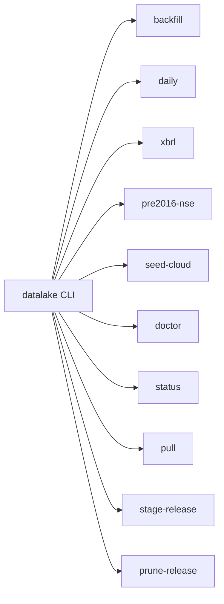
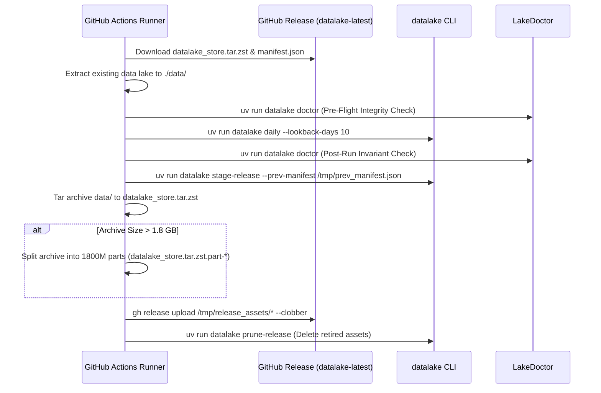

# bfinance-datalake: CLI Reference & Operational Runbook

This document provides complete operational guidance for administering, scheduling, synchronizing, and troubleshooting **`bfinance-datalake`** in local and cloud environments.

---

## 1. CLI Commands Reference

The CLI entrypoint is registered as `datalake` in `pyproject.toml` pointing to `datalake.cli:main`. In development, execute commands via `uv run datalake <command> [options]`.



### Global Flag
- `--data-dir <path>`: Sets root directory for Parquet data and `state.db`. Defaults to `./data` (or `$BFINANCE_LAKE_DIR`).

---

### 1.1. `datalake backfill`
Downloads, normalizes, and stitches full historical datasets across equities, derivatives, indices, flows, deals, and mutual funds.

```bash
uv run datalake backfill --start 2016-01-01 [--end YYYY-MM-DD] [--include-fo] [--amfi-history] [--force]
```

#### Arguments
| Argument | Type | Default | Description |
| :--- | :--- | :--- | :--- |
| `--start` | `str` | `"2016-01-01"` | Start date in `YYYY-MM-DD` format. |
| `--end` | `str` | Today (IST) | End date in `YYYY-MM-DD` format. |
| `--include-fo` | Flag | `False` | Also backfills daily NSE/BSE F&O Option Chains and Futures. |
| `--amfi-history` | Flag | `False` | Also backfills 30-day AMFI NAV windows since April 2006. |
| `--force` | Flag | `False` | Forces re-download and re-parsing of partitions even if already marked `OK`. |

#### Ingestion Lifecycle (Steps 1 to 6)
1. **Pre-Flight Doctor**: Cleans temporary files and reconciles `state.db`.
2. **Step 1/6**: Ingests security masters (`EQUITY_L`, `SME_EQUITY_L`, `bse_scrip_master`), symbol renames, PIT constituents, and 30-year parsed corporate actions.
3. **Step 2/6**: Backfills 30-year Nifty indices (OHLC, TRI, P/E, P/B, Div Yield) and daily all-index snapshots.
4. **Step 3/6**: Ingests NSE & BSE daily equity bhavcopies, trades, turnover, and gross delivery.
5. **Step 4/6** (if `--include-fo`): Ingests derivatives bhavcopies, strike grids, settlement prices, and open interest.
6. **Step 5/6**: Syncs F&O participant OI, cash FII/DII daily flows, bulk/block deals, insider trading (PIT), and concall filings.
7. **Step 6/6**: Syncs daily AMFI NAVs and backfills 30-day NAV history (if `--amfi-history`).
8. **Post-Run Doctor**: Verifies invariants and schema integrity.

---

### 1.2. `datalake daily`
Executes incremental synchronization from the last recorded watermarks in `state.db` up to today IST. Designed for automated end-of-day cron jobs.

```bash
uv run datalake daily [--lookback-days 7] [--no-fo]
```

#### Arguments
| Argument | Type | Default | Description |
| :--- | :--- | :--- | :--- |
| `--lookback-days` | `int` | `7` | Fallback lookback window if a dataset has no watermarks in `state.db`. |
| `--no-fo` | Flag | `False` | Skips daily derivatives (F&O) synchronization. |

#### Operational Behavior
- Executes in ~20–35 seconds during weekday evenings.
- Reads `max_ok_date` for each dataset from `state.db`.
- Fetches new equity bhavcopies, delivery percentages, option chains, daily index snapshots, participant OI, bulk/block deals, cash FII/DII flows, and recent Ind-AS XBRL filings.
- Re-runs `LakeDoctor` to guarantee schema compliance.

---

### 1.3. `datalake xbrl`
Synchronizes Ind-AS XBRL quarterly/annual financial statements, multi-decade shareholding patterns, promoter pledge, $>1\%$ institutional holders, and annual reports.

```bash
uv run datalake xbrl [--symbols SYMS] [--bse-scrips SCRIPS] [--all-market] [--limit N] [--force]
```

#### Arguments
| Argument | Type | Default | Description |
| :--- | :--- | :--- | :--- |
| `--symbols` | `str` | `"RELIANCE,TCS,..."` | Comma-separated list of NSE symbols. |
| `--bse-scrips` | `str` | `"500325,532540,..."`| Comma-separated list of BSE scrip codes. |
| `--all-market` | Flag | `False` | Iterates across all listed NSE & BSE companies in security masters. |
| `--limit` | `int` | `None` | Optional cap on number of companies when running `--all-market`. |
| `--force` | Flag | `False` | Forces re-sync even if symbols are already marked completed in `state.db`. |

---

### 1.4. `datalake pre2016-nse`
Backfills 1995–2015 NSE cash equities and gross delivery for specified symbols using NSE's official `/api/historicalOR` endpoint.

```bash
uv run datalake pre2016-nse --symbols RELIANCE,TCS,INFY --start-year 1995 --end-year 2015
```

#### Arguments
| Argument | Type | Default | Description |
| :--- | :--- | :--- | :--- |
| `--symbols` | `str` | `"RELIANCE,TCS,..."` | Comma-separated list of NSE symbols. |
| `--start-year` | `int` | `1995` | Starting historical year. |
| `--end-year` | `int` | `2015` | Ending historical year. |

---

### 1.5. `datalake seed-cloud`
Cloud-native seeding of 2008–2015 NSE cash equities via Upstox's public V2 candle CDN. Bypasses exchange IP blocks and operates seamlessly in GitHub Actions.

```bash
uv run datalake seed-cloud [--start-year 2008] [--end-year 2015] [--limit N]
```

#### Arguments
| Argument | Type | Default | Description |
| :--- | :--- | :--- | :--- |
| `--start-year` | `int` | `2008` | Earliest year (Upstox daily candles start in 2008). |
| `--end-year` | `int` | `2015` | Ending year. |
| `--limit` | `int` | `None` | Optional limit on number of symbols to seed. |

---

### 1.6. `datalake doctor`
Runs the self-healing and crash-recovery audit suite.

```bash
uv run datalake doctor
```

- Cleans orphaned temporary files (`*.tmp`, `*.dl_tmp`, `*.dl.tmp`).
- Validates SQLite integrity (`PRAGMA integrity_check`).
- Purges truncated days failing minimum row-count sanity checks.
- Enforces domain invariants (`repair_ohlc`, shareholding bounds $0 \dots 100\%$, float64 schemas).
- Reconciles `state.db` watermarks with Parquet partitions on disk.

---

### 1.7. `datalake status`
Displays a formatted status summary of dataset watermarks, partition counts, holidays, and total rows from `state.db`.

```bash
uv run datalake status
```

**Example Output:**
```
Data Lake Root: E:\dev\code\bfinance-datalake\data
---------------------------------------------------------------------------------------------------------
Dataset                      | OK Partitions | Holidays |   Total Rows | Earliest     | Latest      
---------------------------------------------------------------------------------------------------------
amfi_nav_daily               |           248 |        0 |    3,571,200 | 2026-01-01   | 2026-11-04  
corporate_actions_bse        |            27 |        0 |       58,410 | 2000         | 2026        
corporate_actions_nse_equities|           32 |        0 |       82,140 | 1995         | 2026        
equity_eod_bse               |         4,892 |      612 |   14,210,500 | 2006-03-01   | 2026-11-04  
equity_eod_nse               |         7,720 |      890 |   24,180,400 | 1994-11-03   | 2026-11-04  
fo_eod_nse                   |         6,310 |      740 |   85,420,100 | 2000-06-12   | 2026-11-04  
indices_30y_bulk             |            17 |        0 |      118,500 | NIFTY 50     | INDIA VIX   
indices_daily_all            |         3,410 |      420 |      409,200 | 2012-01-02   | 2026-11-04  
nse_participant_oi           |         3,240 |      390 |       12,960 | 2012-09-03   | 2026-11-04  
security_master              |             7 |        0 |       14,500 | bse_equity   | nse_symbol_changes
---------------------------------------------------------------------------------------------------------
```

---

### 1.8. `datalake pull`
Executes an ultra-fast SHA-256 delta sync from a GitHub Release to local disk. Only downloads Parquets whose size or checksum differs from local disk.

```bash
uv run datalake pull --repo esconer/bfinance-datalake [--tag datalake-latest] [--token PAT] [--pattern 2026]
```

#### Arguments
| Argument | Type | Default | Description |
| :--- | :--- | :--- | :--- |
| `--repo` | `str` | Required | GitHub repository (`"username/repo-name"`). |
| `--tag` | `str` | `"datalake-latest"` | Release tag. |
| `--token` | `str` | `None` | Optional GitHub Personal Access Token for private repositories. |
| `--pattern` | `str` | `None` | Optional regex or substring filter (e.g. `'2026'` or `'equities'`). |

---

### 1.9. `datalake stage-release`
Optimizes Parquet layouts, generates `manifest.json`, builds compacted historical bundles and per-ticker packfiles, and stages assets for GitHub Releases upload. Used primarily in GitHub Actions CI/CD workflows.

```bash
uv run datalake stage-release [--staging-dir /tmp/release_assets] [--prev-manifest /tmp/prev_manifest.json]
```

---

### 1.10. `datalake prune-release`
Compares assets in a GitHub Release against the active `manifest.json` and deletes retired or orphaned files using the GitHub CLI (`gh`).

```bash
uv run datalake prune-release [--tag datalake-latest] [--staging-dir /tmp/release_assets]
```

---

## 2. Cloud Automation Pipeline (GitHub Actions)

Continuous synchronization and release publishing are orchestrated via `.github/workflows/daily_sync.yml`.

### 2.1. Cron Schedule
1. **19:15 IST (13:45 UTC) Mon–Fri**:
   - Primary daily EOD ingestion: NSE & BSE Bhavcopies, UDIFF Delivery, F&O Option Chains, Multi-Index Snapshots, Deals, and Institutional Flows.
2. **22:00 IST (16:30 UTC) Mon–Fri**:
   - Secondary catch-up: AMFI Mutual Fund `NAVAll.txt` ingestion and late evening corporate filings.

### 2.2. Concurrency Control
```yaml
concurrency:
  group: datalake-release-lock
  cancel-in-progress: false
```
Guarantees sequential execution in a FIFO queue. Prevents overlapping runs from clobbering release assets or overwriting `state.db`.

### 2.3. Cloudflare WARP Firewall Bypass
Indian exchange endpoints frequently block traffic originating from standard cloud provider IP ranges (GitHub Actions Azure/AWS IP pools). The workflow installs and activates the official Cloudflare WARP daemon:
```bash
curl -fsSL https://pkg.cloudflareclient.com/pubkey.gpg | sudo gpg --yes --dearmor --output /usr/share/keyrings/cloudflare-warp-archive-keyring.gpg
echo "deb [signed-by=/usr/share/keyrings/cloudflare-warp-archive-keyring.gpg] https://pkg.cloudflareclient.com/ $(lsb_release -cs) main" | sudo tee /etc/apt/sources.list.d/cloudflare-client.list
sudo apt-get update -y && sudo apt-get install -y cloudflare-warp
sudo systemctl start warp-svc
warp-cli --accept-tos registration new
warp-cli --accept-tos mode warp
warp-cli --accept-tos connect
```
Routes outbound runner traffic through Cloudflare residential/edge IPs, bypassing Akamai IP reputation blocks.

### 2.4. Ingestion & Release Packaging Lifecycle


---

## 3. Disaster Recovery & Troubleshooting Runbook

### 3.1. Corrupted `state.db`
- **Symptom**: SQLite errors such as `DatabaseError: database disk image is malformed` or `OperationalError: disk I/O error`.
- **Automated Fix**: Run `uv run datalake doctor`. The doctor detects `PRAGMA integrity_check` failure, moves the corrupt database to `data/state.db.corrupt`, creates a new `state.db`, and reconstructs watermarks directly by inspecting Parquet files on disk.
- **Manual Fix**:
  ```bash
  mv data/state.db data/state.db.bak
  uv run datalake doctor
  uv run datalake status
  ```

### 3.2. Windows `PermissionError` on File Replacement
- **Symptom**: `PermissionError: [WinError 32] The process cannot access the file because it is being used by another process`.
- **Root Cause**: An active Python process (or anti-virus scanner) is holding an open file descriptor on a Parquet partition during `os.replace`.
- **Remedy**:
  - `storage.py` and `sync.py` include built-in 8-iteration retry loops with `gc.collect()`.
  - Ensure background DuckDB cursors are closed via `lake.close()` or `remote.close()`.
  - Exclude the `data/` directory from active real-time Windows Defender / anti-virus scans.

### 3.3. HTTP 403 / 401 Akamai Blocks
- **Symptom**: Repeated `HTTP 403 Forbidden` from `www.nseindia.com` or `niftyindices.com`.
- **Remedy**:
  - The client automatically rotates impersonation profiles (`chrome124` $\to$ `chrome120` $\to$ `chrome116`) and re-primes cookies.
  - If running in cloud environments (AWS, GCP, GitHub Actions), enable Cloudflare WARP or route through an Indian residential proxy.
  - Temporarily increase `polite_delay_sec` in `LakeConfig` from `0.25` to `0.75`.

### 3.4. Re-fetching a Specific Damaged Partition
To force re-download of a specific dataset or year without wiping the entire data lake:
```bash
# 1. Delete the specific Parquet file:
rm data/equities/nse_cm_2024.parquet

# 2. Run doctor to purge the stale state.db watermarks:
uv run datalake doctor

# 3. Re-run backfill for that specific year:
uv run datalake backfill --start 2024-01-01 --end 2024-12-31 --force
```
