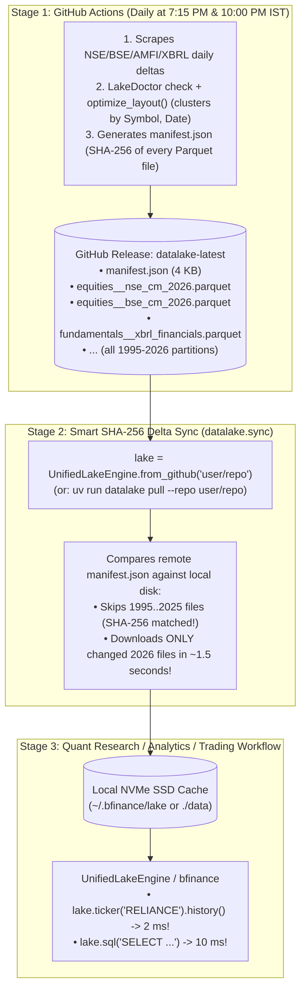

# Smart Cloud Delta Sync & GitHub Releases Engine (`datalake.sync`)

The **Cloud Delta Sync Engine** provides a 3-stage architecture enabling **zero local scraping**, **~1.5-second daily delta syncs**, and **1–5 millisecond local query execution**.

---

## 3-Stage Architecture Overview



### Why This Architecture Outperforms Direct Streaming

1. **Zero Network Latency During Analysis:**
   Streaming Parquet data over HTTPS on every backtest or query adds 200–500 ms of network latency per lookup. Syncing once locally gives you **1–5 ms local NVMe SSD speeds**.
2. **Immutable Historical Partitions:**
   Files from 1995 to 2025 never change. A 4 KB `manifest.json` on the release indexes the SHA-256 checksum and size of every `.parquet` partition. Your local sync checks the manifest in ~150 ms, confirms historical years match, and **only downloads the 3–4 files modified today** (`nse_cm_2026.parquet`, `bse_cm_2026.parquet`, `amfi_nav_2026.parquet`).
3. **Bandwidth Savings:**
   Instead of downloading a multi-gigabyte zip archive daily, daily bandwidth consumption is typically **< 15 MB**.

---

## CLI Usage

### 1. Pulling Updates Locally (`datalake pull`)

Sync the latest daily delta to your local data folder:

```bash
# Public repository
uv run datalake pull --repo your-username/bfinance-datalake

# Custom destination and private repo
uv run datalake pull --repo your-username/bfinance-datalake --data-dir ~/.bfinance/lake --token ghp_xxxx
```

Output:
```text
[Lake Pull] 45 files up-to-date locally, 3 changed/new files to download from your-username/bfinance-datalake...
[Lake Pull] Synced equities/nse_cm_2026.parquet (625 KB)
[Lake Pull] Synced equities/bse_cm_2026.parquet (698 KB)
[Lake Pull] Synced mutual_funds/amfi_nav_2026.parquet (252 KB)
Sync Summary: {'up_to_date_skipped': 45, 'downloaded': 3, 'total_files': 48}
```

### 2. Staging for GitHub Actions (`datalake stage-release`)

Used inside CI/CD workflows prior to `gh release upload`:

```bash
uv run datalake stage-release --staging-dir /tmp/release_assets
```

This command:
1. Calls `UnifiedLakeEngine.optimize_layout()` to re-cluster all Parquet files by `(Symbol, Date)` for sub-5ms predicate pushdown.
2. Computes SHA-256 checksums and writes `manifest.json`.
3. Renames nested files into flat, release-safe names (e.g., `equities/nse_cm_2026.parquet` $\to$ `equities__nse_cm_2026.parquet`).
4. Stages `manifest.json`, `state.db`, and all partitions < 1.95 GB into the staging folder.

---

## Python API Usage

### `UnifiedLakeEngine.from_github()`

One-line initialization that automatically runs delta sync before loading:

```python
from datalake.engine import UnifiedLakeEngine

# Auto-syncs changed partitions in ~1.5s, then returns a ready engine
lake = UnifiedLakeEngine.from_github(
    repo="your-username/bfinance-datalake",
    lake_dir="~/.bfinance/lake",
    auto_sync=True,  # Set to False to skip sync and use local cache
)

# All queries execute against local NVMe SSD in 1 to 5 ms
reliance = lake.ticker("RELIANCE")
df_ohlcv = reliance.history(start="2000-01-01", auto_adjust=True)
df_qtr   = reliance.quarterly_financials
df_shp   = reliance.shareholding
df_opt   = lake.option_chain("NIFTY")
```

---

## GitHub Actions Workflow Integration

In `.github/workflows/daily_sync.yml`, the release step publishes flat assets and the `manifest.json`:

```yaml
      - name: Stage, Verify & Publish Updated Data Lake to GitHub Release (`datalake-latest`)
        if: always()
        env:
          GH_TOKEN: ${{ github.token }}
        run: |
          if [ -d data ] && [ -f data/state.db ]; then
            uv run datalake stage-release --staging-dir /tmp/release_assets
            tar --zstd -cf /tmp/release_assets/datalake_store.tar.zst data/
            tar --zstd -tf /tmp/release_assets/datalake_store.tar.zst >/dev/null
            gh release upload datalake-latest /tmp/release_assets/* --clobber
          fi
```

---

## Module Function Reference

### `datalake.sync.compute_sha256(path: Path) -> str`
Computes the SHA-256 hex digest of `path` reading in 1 MB chunks to prevent memory spikes.

### `datalake.sync.build_manifest(data_dir: Path) -> dict`
Scans all `.parquet` files recursively in `data_dir`, generates release asset names (`folder__file.parquet`), computes size and SHA-256, and writes `data_dir / manifest.json`.

### `datalake.sync.prepare_release_staging(data_dir: Path, staging_dir: Path) -> dict`
Optimizes layout, generates manifest, and populates `staging_dir` with flat assets ready for upload to GitHub Releases.

### `datalake.sync.pull_from_github_release(repo, data_dir, tag="datalake-latest", token=None, concurrency=4) -> dict[str, int]`
Asynchronously fetches `manifest.json`, compares local files by size and SHA-256, downloads updated assets with concurrency limiting, verifies checksums on temp files, and atomically replaces local files.
