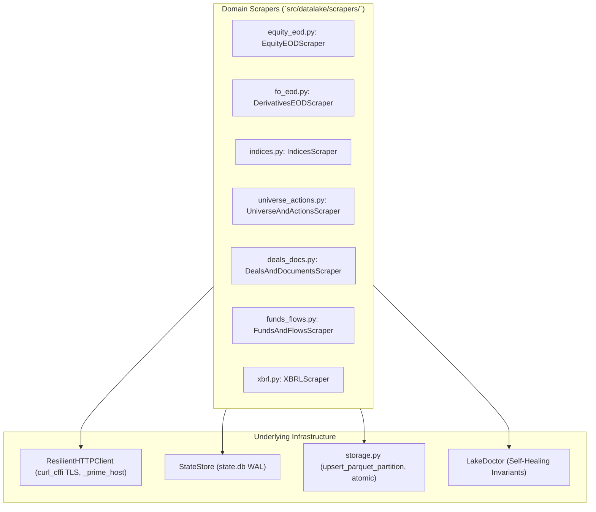

# bfinance-datalake: Scrapers Implementation Reference

This document provides a line-by-line, module-by-module technical specification of all seven scraper implementations located in `src/datalake/scrapers/`.

---

## 1. Scraper Architecture Overview

All scrapers inherit a unified operational pattern:
- **Resilient Network Access**: Accept an instance of `ResilientHTTPClient` (`datalake.http_client`) configured with TLS fingerprint impersonation (`curl_cffi` Chrome 124/120/116) and host session priming.
- **State & Checkpoint Store**: Accept `StateStore` (`datalake.state`) to check completed partition keys, persist watermarks, log SHA-256 digests, and record market holidays.
- **Lake Configuration**: Accept `LakeConfig` (`datalake.config`) for root directories, concurrency limits (`archive_concurrency`, `api_concurrency`), and rate limits (`polite_delay_sec`).
- **Atomic Parquet Merging**: Feed parsed DataFrames to `upsert_parquet_partition` (`datalake.storage`) for deduplicated, sorted, and atomic Zstandard-compressed Parquet writes.

---

## 2. Equity EOD Scraper (`equity_eod.py`)

**File:** `src/datalake/scrapers/equity_eod.py` (667 lines)

### Purpose
Ingests daily cash market End-of-Day (EOD) OHLCV, gross delivery volumes, delivery percentages, turnover, number of trades, and ISIN codes across 30+ years for the National Stock Exchange of India (NSE, 1994+) and BSE Ltd. (2006+).

### Key Cutover Dates & Constants
- `NSE_LEGACY_START = date(1994, 11, 3)`: Inception of electronic trading and legacy bhavcopy files on NSE.
- `BSE_LEGACY_START = date(2006, 3, 1)`: Inception of downloadable electronic equity bhavcopies on BSE.
- `NSE_UDIFF_CUTOVER = date(2024, 1, 2)`: NSE cutover to the SEBI Unified Data Interchange Format (UDIFF).
- `NSE_FULL_BHAV_CUTOVER = date(2020, 1, 1)`: NSE inception of `sec_bhavdata_full_DDMMYYYY.csv`.
- `BSE_UDIFF_CUTOVER = date(2024, 7, 8)`: BSE cutover to the UDIFF BhavCopy format.
- `_BSE_GLUED_LINE_RE = re.compile(r"(\d+\.\d{2}),(\d{6},[A-Z0-9])")`: Fixes legacy BSE zipped CSV corruption where newlines were missing between rows.

### Helper Functions
- **`repair_ohlc(df: pd.DataFrame) -> pd.DataFrame`**:
  Repairs historical data anomalies (common in 1995–2003 NSE legacy files):
  1. Coerces `Open`, `High`, `Low`, `Close`, `PrevClose` to `float64`.
  2. If `Open <= 0` or missing, replaces it with `PrevClose` (or `Close` if `PrevClose <= 0`).
  3. Replaces `High` and `Low` if zero with $\max(\text{Open}, \text{Close})$ and $\min(\text{Open}, \text{Close})$.
  4. Swaps values if `High < Low`.
  5. Enforces bounding invariants: `High = np.maximum(High, max(Open, Close))` and `Low = np.minimum(Low, min(Open, Close))`.
- **`filter_bse_equity_only(df: pd.DataFrame) -> pd.DataFrame`**:
  BSE legacy equity bhavcopies bundled government debt and corporate bonds into the equity file. This function strips:
  - Government securities: `Series == 'G'`.
  - Corporate bonds: `Series == 'F'` with an `INE` prefix in the ISIN code.

### Class: `EquityEODScraper`
- **`sync_range(start_date, end_date, exchanges=("NSE", "BSE"), force=False)`**:
  - Iterates year-by-year across the date range.
  - Generates list of weekdays not marked `OK` or `HOLIDAY` in `state.db`.
  - Downloads days in parallel 22-day micro-batches governed by `asyncio.Semaphore(cfg.archive_concurrency)`.
  - Truncation Guard: For years $\ge 2016$, if a returned trading day has $< 200$ rows, it is flagged as `FAILED` rather than committed.
  - Appends valid days to `equities/{exch}_cm_{year}.parquet` via `upsert_parquet_partition()`.
- **`fetch_nse_day(day: date)`**:
  Implements a 3-tier temporal fallback:
  1. **Post-2024 (`day >= NSE_UDIFF_CUTOVER`)**: Concurrently fetches `_fetch_nse_sec_bhavdata_full(day)` and `_fetch_nse_udiff(day)`. Merges UDIFF OHLCV and trades with full delivery quantities.
  2. **2020–2024 (`day >= NSE_FULL_BHAV_CUTOVER`)**: Concurrently fetches `sec_bhavdata_full` and legacy CM bhavcopy. Merges delivery with legacy ISIN mappings. If `sec_bhavdata_full` is unavailable, falls back to legacy CM + MTO gross delivery.
  3. **Pre-2020 (`day < NSE_FULL_BHAV_CUTOVER`)**: Fetches `_fetch_nse_legacy_cm(day)` and joins gross delivery from `_fetch_nse_mto_delivery(day)` (`MTO_DDMMYYYY.DAT`).
- **`seed_pre2016_via_upstox_cdn(start_year=2008, end_year=2015, max_symbols=None)`**:
  - Cloud/CI-safe backfill for 2008–2015 NSE equities bypassing exchange IP blocks.
  - Queries Upstox Public V2 historical candle endpoint (`/v2/historical-candle/NSE_EQ|{isin}/day/{end}/{start}`) in 4-year windows.
  - Parses daily candles into standard `bfinance-datalake` equity schema and commits to annual Parquet partitions.
- **`backfill_nse_symbol_via_historical_or(symbol, start_year=1995, end_year=2015)`**:
  - Direct pre-2016 fallback querying NSE's official `/api/historicalOR/generateSecurityWiseHistoricalData`.
  - Resolves historical symbol renames via `SymbolRenameResolver` for both Jan 1 and Dec 31 of each year.
  - Parses CSV payloads containing Open, High, Low, Close, PrevClose, Total Traded Qty, Turnover, Trades, and Deliverable Qty.
- **`fetch_bse_day(day: date)`**:
  - **Post-July 2024**: Downloads BSE UDIFF CSV from `https://www.bseindia.com/download/BhavCopy/Equity/BhavCopy_BSE_CM_0_0_0_{YYYYMMDD}_F_0000.CSV`.
  - **Pre-July 2024**: Downloads legacy `EQ{DDMMYY}_CSV.ZIP` and `EQ_ISINCODE_{DDMMYY}.zip`.
  - Fixes missing line breaks via `_BSE_GLUED_LINE_RE`, filters to equity shares (`SC_TYPE == 'Q'`), merges ISINs, and joins gross delivery from `SCBSEALL{DDMM}.zip`.

---

## 3. Derivatives F&O Scraper (`fo_eod.py`)

**File:** `src/datalake/scrapers/fo_eod.py` (216 lines)

### Purpose
Ingests daily End-of-Day (EOD) derivatives bhavcopies for Index Futures, Stock Futures, Index Options, and Stock Options across NSE (June 2000+) and BSE (July 2024+).

### Key Cutover Dates & Constants
- `NSE_FO_START = date(2000, 6, 12)`: Inception date of Nifty 50 Index Futures on NSE.
- `BSE_FO_START = date(2024, 7, 8)`: BSE cutover to the UDIFF derivatives format.
- `FO_UDIFF_CUTOVER = date(2024, 7, 8)`: NSE & BSE transition to the Unified Data Interchange Format.
- `_FO_SYMBOL_MAP`: Normalizes legacy index names to modern canonical identifiers:
  - `S&P CNX NIFTY` / `CNX NIFTY` $\to$ `NIFTY`
  - `CNX BANK` / `BANK NIFTY` $\to$ `BANKNIFTY`
  - `CNX IT` / `CNXIT` $\to$ `NIFTYIT`
  - `NFTYMCAP50` $\to$ `NIFTYMID50`

### Class: `DerivativesEODScraper`
- **`sync_range(start_date, end_date, exchanges=("NSE",), force=False)`**:
  - Iterates year-by-year across the date range.
  - Dispatches parallel downloads in 66-day micro-batches using `archive_concurrency`.
  - Filters contracts to active trading instruments (`Contracts > 0` or `OpenInterest > 0`).
  - Upserts to `derivatives/{exch}_fo_{year}.parquet` deduplicated on:
    `["Date", "Exchange", "InstrumentType", "Symbol", "ExpiryDate", "StrikePrice", "OptionType"]`.
- **`fetch_nse_fo_day(day: date)`**:
  - Returns `None` if `day < 2000-06-12`.
  - **Post-July 2024**: Downloads `BhavCopy_NSE_FO_0_0_0_{YYYYMMDD}_F_0000.csv.zip` and normalizes via `_normalize_fo_udiff()`.
  - **Pre-July 2024**: Downloads legacy `fo{DD}{MON}{YYYY}bhav.csv.zip`.
  - Cleans column headers, handles multiple `INSTRUMENT` header rows, normalizes `EXPIRY_DT` to timestamps, sets `OptionType="XX"` for futures, and replaces zero closing prices with `SettlePrice`.
- **`fetch_bse_fo_day(day: date)`**:
  - Downloads `BhavCopy_BSE_FO_0_0_0_{YYYYMMDD}_F_0000.CSV` from BSE.
- **`_normalize_fo_udiff(df, day, exchange)`**:
  - Maps UDIFF fields: `FinInstrmTp` $\to$ `InstrumentType`, `TckrSymb` $\to$ `Symbol`, `XpryDt` $\to$ `ExpiryDate`, `StrkPric` $\to$ `StrikePrice`, `OptnTp` $\to$ `OptionType`, `ClsPric` $\to$ `Close`, `SttlmPric` $\to$ `SettlePrice`, `UndrlygPric` $\to$ `UnderlyingPrice`, `OpnIntrst` $\to$ `OpenInterest`, `ChngInOpnIntrst` $\to$ `ChangeInOI`.

---

## 4. Indices Scraper (`indices.py`)

**File:** `src/datalake/scrapers/indices.py` (400 lines)

### Purpose
Scrapes 30 years of continuous Nifty index data (OHLC, Total Return Index / TRI, P/E, P/B, Div Yield) and daily market-wide multi-index snapshots (120+ indices).

### Constants & Mappings
- **`CORE_NIFTY_INDICES`**: 17 benchmark indices including NIFTY 50, NIFTY NEXT 50, NIFTY 100, NIFTY 200, NIFTY 500, NIFTY MIDCAP 150, NIFTY SMALLCAP 250, sectoral indices (BANK, IT, AUTO, PHARMA, FMCG, METAL, REALTY, ENERGY), INDIA VIX, and NIFTY 1D RATE INDEX.
- **`_LEGACY_INDEX_MAP`**: Normalizes legacy CNX index designations (`CNX NIFTY` $\to$ `NIFTY 50`, `CNX 500` $\to$ `NIFTY 500`, etc.).
- **`BASE_POST_URL = "https://www.niftyindices.com/BackPage"`**: Official Sitefinity MVC JSON backend.

### Class: `IndicesScraper`
- **`backfill_30y_bulk(start_date=1995-01-01, end_date=None, indices=CORE_NIFTY_INDICES, force=False)`**:
  - Inspects existing coverage in `indices/nifty_30y_ohlc_tri_pe.parquet`. If an index has $\ge 500$ rows, calculates the incremental start date to fetch only missing days.
  - Concurrently invokes `_post_nifty()` across three endpoints:
    1. `getHistoricaldatatabletoString`: OHLC prices.
    2. `getTotalReturnIndexString`: Total Return Index (TRI).
    3. `getpepbHistoricaldataDBtoString`: Valuation ratios (P/E, P/B, Dividend Yield).
  - **NSE HistoricalOR Fallback**: If `niftyindices.com` returns empty or fails, automatically falls back to `_fetch_nse_historical_or_index()`.
  - Merges OHLC, TRI, and valuation metrics on `Date` and commits to `nifty_30y_ohlc_tri_pe.parquet`.
- **`_post_nifty(index_name, start, end, method, extra="")`**:
  - Chunks requests into 365-day windows.
  - Sends POST requests with JSON payload: `{"cinfo": "{'name': '...', 'startDate': 'DD-Mon-YYYY', 'endDate': 'DD-Mon-YYYY', 'indexName': '...'}"}`.
  - Unpacks Sitefinity nested JSON string responses (`payload['d']`).
- **`_fetch_nse_historical_or_index(index_name, start, end)`**:
  - Queries NSE's `/api/historicalOR/indicesHistory?indexType={index}&from={start}&to={end}` in 365-day chunks with host priming.
- **`sync_daily_snapshots(start_date, end_date)`**:
  - Ingests daily market-wide CSVs from `https://nsearchives.nseindia.com/content/indices/ind_close_all_{DDMMYYYY}.csv` (2012+).
  - Cleans UTF-8 BOM characters, extracts Open, High, Low, Close, Volume, Turnover, PE, PB, and DivYield across all 120+ indices.
  - Writes to `indices/ind_close_all_{year}.parquet`.
  - **India VIX Extraction**: Extracts INDIA VIX records and upserts them into `nifty_30y_ohlc_tri_pe.parquet` to support quantitative volatility modeling.
- **`sync_vix_and_1d_rate_from_snapshots() -> int`**:
  - Scans all `ind_close_all_*.parquet` files and extracts `INDIA VIX` and `NIFTY 1D RATE INDEX` into the continuous 30-year master table.

---

## 5. Universe & Actions Scraper (`universe_actions.py`)

**File:** `src/datalake/scrapers/universe_actions.py` (375 lines)

### Purpose
Synchronizes security masters (NSE & BSE), the 1,078-symbol rename history DAG, point-in-time (PIT) index constituents, upcoming board meetings, F&O ban lists, and 30 years of corporate actions.

### Regex Parser: `parse_action_purpose(text, face_value=None)`
Transforms raw, unstructured exchange announcement text into structured numerical fields:
1. **Non-Equity Filter (`_NON_EQUITY_ISSUE_RE`)**: Detects debentures, bonds, preference shares, and warrants, tagging them as `SKIP_NON_EQUITY`.
2. **Face Value Extraction (`_FV_EXTRACT_RE`)**: Detects face value notation (e.g., `FV Rs 10`) to calculate percentage dividends correctly.
3. **Dividend Extraction (`_DIV_RE` & `_PCT_DIV_RE`)**:
   - Parses absolute cash dividends: `Rs 5.50 per share`, `₹ 12/-`.
   - Parses percentage dividends: `Dividend 250%` $\to$ calculates $2.50 \times \text{Face Value}$.
4. **Bonus Extraction (`_BONUS_RE`)**: Parses `Bonus 1:1`, `Bonus 2:1`, calculating `ShareMultiplier = (BonusNew + BonusHeld) / BonusHeld`.
5. **Split Extraction (`_SPLIT_RE`)**: Parses `Split from Rs 10 to Rs 2`, calculating `ShareMultiplier = SplitFromFV / SplitToFV`.
6. **Rights / Demergers / Buybacks**: Flags special corporate restructuring actions.

### Class: `UniverseAndActionsScraper`
- **`sync_security_masters()`**:
  - Ingests official security lists: `EQUITY_L.csv`, `SME_EQUITY_L.csv`, `eq_etfseclist.csv`, `delisted.csv`.
  - Downloads `symbolchange.csv` and builds `universe/nse_symbol_changes.parquet`.
  - Queries BSE API (`/BseIndiaAPI/api/ListofScripData/w`) for active and suspended equities, saving to `universe/bse_scrip_master.parquet`.
  - Downloads current constituent lists for 15 Nifty indices and timestamps them into `universe/nifty_constituents_pit.parquet`.
- **`sync_upcoming_calendar_and_fo_ban()`**:
  - Queries NSE `/api/corporate-board-meetings?index=equities` for upcoming earnings announcements and saves to `actions/upcoming_board_meetings.parquet`.
  - Downloads `https://nsearchives.nseindia.com/content/fo/fo_secban.csv` and saves to `derivatives/fo_ban_list.parquet`.
- **`sync_corporate_actions(start_year=2000, end_year=None, force=False)`**:
  - Queries BSE API (`/BseIndiaAPI/api/DefaultData/w`) year-by-year for equity corporate actions (`ddlcategorys=E`).
  - Runs `parse_action_purpose()` on every filing.
  - Normalizes numeric columns to `float64` via `_normalize_action_frame()`.
  - Saves to `actions/bse_corporate_actions.parquet`.
- **`sync_nse_corporate_actions(start_year=1995, end_year=None, force=False)`**:
  - Queries NSE `/api/corporates-corporateActions` across both `equities` (1995+) and `sme` (2013+) in annual chunks with host priming.
  - Parses purpose text and saves to `actions/nse_corporate_actions.parquet`.

---

## 6. Deals & Documents Scraper (`deals_docs.py`)

**File:** `src/datalake/scrapers/deals_docs.py` (334 lines)

### Purpose
Ingests Bulk and Block deals (2004+), SEBI PIT insider trading disclosures, cash-market FII/DII daily net flows, BSE earnings call transcripts and presentations, and the 20-year official corporate Annual Report catalog.

### Helper: `_normalize_deals_frame(df, deal_type, exchange="NSE")`
Standardizes deals from daily static CSVs and historical archive endpoints:
- Maps legacy column headers (`BD_DT_DATE`, `BD_SYMBOL`, `BD_CLIENT_NAME`, `BD_QTY_TRD`, `BD_TP_WATP`) to standardized names.
- Coerces traded quantity and weighted average price to floats.
- Normalizes trading date timestamps.

### Class: `DealsAndDocumentsScraper`
- **`sync_bulk_and_block_deals()`**:
  - Downloads daily static files: `bulk.csv` and `block.csv` from NSE archives.
  - Appends to `deals/bulk_block_deals.parquet`.
- **`backfill_historical_bulk_block_deals(start_year=2005, end_year=None, force=False)`**:
  - Queries NSE HistoricalOR endpoint: `/api/historicalOR/bulk-block-short-deals?optionType={type}&from=01-01-{yr}&to=31-12-{yr}&csv=true`.
  - Backfills 20+ years of historical block/bulk transactions.
- **`sync_insider_trading_pit(start_date, end_date, force=False)`**:
  - Queries NSE `/api/corporates-pit?index=equities` in 89-day chunks (respecting NSE's 90-day API limit).
  - Captures SEBI Regulation 7(2) disclosures: insider names, transaction types, share counts, and values.
  - Saves to `deals/insider_trading_pit.parquet`.
- **`sync_cash_fii_dii_daily()`**:
  - Queries NSE `/api/fiidiiTradeReact` for daily provisional cash market institutional purchases, sales, and net flows.
  - Saves to `flows/cash_fii_dii_flows.parquet`.
- **`sync_concalls_and_presentations(start_date, end_date, scrip_code="")`**:
  - Queries BSE `/BseIndiaAPI/api/AnnSubCategoryGetData/w` in 28-day windows across 5 categories: Earnings Call Transcripts, Investor Presentations, Audio/Video Recordings, Credit Ratings, and Press Releases.
  - Constructs direct PDF download links: `https://www.bseindia.com/xml-data/corpfiling/{AttachLive|AttachHis}/{attachment}`.
  - Saves metadata to `documents/concalls_and_filings.parquet`.
- **`sync_annual_reports_nse(symbols: list[str])`**:
  - Queries NSE `/api/annual-reports?index=equities&symbol={symbol}`.
  - Captures 17+ continuous fiscal years of official PDF links.
- **`sync_annual_reports_bse(scrip_codes: list[str], symbols=None)`**:
  - Queries BSE `/BseIndiaAPI/api/AnnualReport/w?scripcode={scrip}&type=C`.
  - Appends PDF links to `documents/annual_reports.parquet`.

---

## 7. Funds & Flows Scraper (`funds_flows.py`)

**File:** `src/datalake/scrapers/funds_flows.py` (332 lines)

### Purpose
Ingests daily and historical Net Asset Values (NAVs) across 14,400+ AMFI mutual fund schemes (2006+) with failover mechanisms, and scrapes NSE Clearing (NSCCL) F&O participant open interest.

### Constants & Mirrors
- **`AMFI_DAILY_MIRRORS`**: Multi-mirror failover URLs for daily NAV text files:
  1. `https://portal.amfiindia.com/spages/NAVAll.txt`
  2. `https://www.amfiindia.com/spages/NAVAll.txt`
  3. `https://portal.amfiindia.com/spages/NavOpen.txt`
- **`CORE_MFAPI_SCHEMES`**: Benchmark schemes used for weekend maintenance failover via `api.mfapi.in` (e.g., HDFC Flexi Cap, Parag Parikh Flexi Cap).

### Class: `FundsAndFlowsScraper`
- **`sync_amfi_daily()`**:
  - Tries each AMFI mirror sequentially with a 90s timeout.
  - Parses semicolon-separated text via `_parse_amfi_text()`.
  - **Weekend Failover**: If AMFI mirrors are unreachable, fetches historical NAVs for flagship schemes from `api.mfapi.in`.
  - Partitions and commits NAV records by year to `mutual_funds/amfi_nav_{year}.parquet`.
- **`backfill_amfi_history(start_date=2006-04-01, end_date=None, force=False)`**:
  - Queries `https://portal.amfiindia.com/DownloadNAVHistoryReport_Po.aspx` in 30-day windows (`frmdt` to `todt`).
  - Executes with concurrency semaphore (`asyncio.Semaphore(3)`) and 120s timeout.
  - Ingests multi-decade NAV histories into annual Parquet partitions.
- **`_parse_amfi_text(raw_text: str) -> pd.DataFrame`**:
  - Handles variable AMC headers, scheme categories, and varying column schemas (6-column and multiple 8-column variants).
  - Validates scheme code digits, positive NAV values, and ISIN formatting (`ISINGrowth`, `ISINReinvest`).
- **`sync_participant_oi(start_date, end_date, force=False)`**:
  - Downloads daily CSV archives from `https://nsearchives.nseindia.com/content/nsccl/fao_participant_oi_{DDMMYYYY}.csv` (September 2012+).
  - Filters to four regulatory categories: `Client`, `DII`, `FII`, `Pro`.
  - Extracts long and short positions across Future Index, Future Stock, Option Index Call, Option Index Put, Option Stock Call, and Option Stock Put.
  - Commits to `flows/fao_participant_oi_{year}.parquet`.

---

## 8. XBRL & Shareholding Scraper (`xbrl.py`)

**File:** `src/datalake/scrapers/xbrl.py` (775 lines)

### Purpose
Discovers, downloads, and parses Ind-AS XBRL financial statements (Balance Sheets, P&L, Cash Flows, Banking metrics) and multi-decade Shareholding Pattern XBRL/iXBRL filings from both NSE and BSE.

### Taxonomy Mappings
- **`XBRL_FIN_TAGS`**: Dictionary mapping 50+ official Ind-AS XML element tags (`in-bse-fin` and `in-bse-bank` taxonomies) to standardized column names (e.g., `RevenueFromOperations` $\to$ `Sales_Cr`, `ProfitLossForPeriod` $\to$ `NetProfit_Cr`, `GrossNonPerformingAssets` $\to$ `GrossNPA_Cr`, `CapitalAdequacyRatio` $\to$ `CapitalAdequacyRatio_Pct`).
- **`UNSCALED_TAGS`**: Elements stored in native units rather than scaled to ₹ Crores (e.g., EPS in Rupees, NPA in percentages).

### Class: `XBRLScraper`
- **`sync_all_market(max_companies=None, force=False) -> tuple[list[str], list[str]]`**:
  - Scans `nse_equity_master.parquet` and `bse_scrip_master.parquet`.
  - Iterates through all listed equities, executing `sync_symbol_financials_nse()`, `sync_symbol_shareholding_nse()`, and `sync_bse_shareholding()` with bounded concurrency.
- **`sync_recent_market_financials_nse(max_new_xmls=100) -> int`**:
  - Queries NSE market-wide feed: `/api/corporates-financial-results?index=equities&period={Quarterly|Annual}`.
  - Detects newly published XBRL links, downloads raw XML, parses Ind-AS statements, and commits to `fundamentals/xbrl_financials.parquet`.
- **`sync_symbol_financials_nse(symbol: str)`**:
  - Queries filing history for a specific company on NSE.
  - Downloads and parses XBRL XML files.
  - **JSON Fallback**: If an XBRL link is `/corporate/xbrl/-` or missing, extracts financial metrics directly from the API's JSON disclosure record via `_extract_json_financial_row()`.
- **`parse_indas_xbrl(xml_bytes, default_symbol, source_url, filing_date=None) -> list[dict]`**:
  - Parses XML with `lxml.etree` using `huge_tree=True`.
  - Classifies reporting duration periods (Quarterly, Half-Yearly, Nine-Months, Annual) via `_classify_duration_days()`.
  - Extracts instant balance sheet facts (Total Assets, Equity Capital, Borrowings, Cash & Bank Balances) and period P&L metrics.
  - Automatically stitches instant balance sheet facts into the corresponding period P&L record matching `PeriodEnd`.
  - Computes `TotalCashAndBank_Cr = CashAndEquivalents + OtherBankBalances` and `TotalBorrowings_Cr = LongTermBorrowings + ShortTermBorrowings`.
- **`sync_symbol_shareholding_nse(symbol: str)`**:
  - Queries `/api/corporate-share-holdings-master?index=equities&symbol={symbol}`.
  - Extracts Promoter, Public, FPI, Mutual Fund, Insurance, and Retail shareholding percentages.
  - If XBRL links are present, invokes `parse_full_shp_xbrl()` to extract promoter pledge and $>1\%$ named shareholders into `shareholding/named_shareholders.parquet`.
- **`sync_bse_shareholding(scrip_code, symbol=None, max_xbrl_quarters=None)`**:
  - Queries BSE `/BseIndiaAPI/api/Corp_Shareholding_ng/w?scripcode={code}&flag=0`.
  - Retrieves multi-decade quarterly shareholding history (e.g., 107 quarters for Reliance back to 2001).
  - Downloads XBRL attachments from `/XBRLFILES/{file}.xml` and parses promoter pledge and institutional holder breakdowns.
- **`parse_full_shp_xbrl(raw_bytes: bytes) -> dict`**:
  - Parses shareholding XBRL contexts, explicit members, and typed members.
  - Resolves promoter pledge (`NumberOfSharesPledgedOrOtherwiseEncumbered`), FPI Category I/II, Mutual Funds, and individual retail investors.
  - Extracts named shareholder details: `CategoryMember`, `HolderName`, `PAN`, `Shares`, `PctOfTotal`, and `PledgedShares`.
