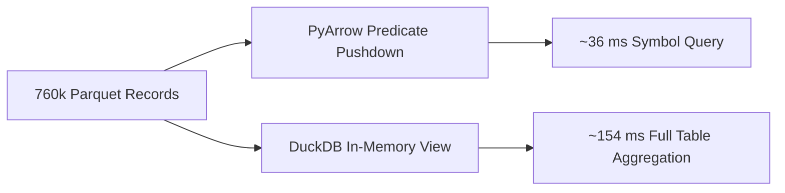

# Empirical Data Testing & Release Verification Audit

This document details the rigorous empirical testing and data quality audit performed on real-world release assets pulled from the **`datalake-latest`** release ([`https://github.com/esconer/bfinance-datalake/releases/tag/datalake-latest`](https://github.com/esconer/bfinance-datalake/releases/tag/datalake-latest)).

Every dataset layer—ranging from raw EOD Cash Equities, Derivatives, Corporate Actions, and 30-Year Index Benchmarks to Security Master Crosswalks and State Store watermarks—was audited for cryptographic integrity, invariant correctness, schema consistency, and end-to-end query performance.

---

## 1. Audit Scope & Selected Partitions

The full release spans 457 Parquet partitions (~1.9 GB) covering 30 years of Indian market history. For high-leverage verification with minimal bandwidth, a curated core testing bundle (< 45 MB total) was selected and tested:

```
data/
├── manifest.json                               # Master SHA-256 cryptographic catalog
├── state.db                                    # SQLite transactional watermark & ingestion log
├── actions/
│   └── nse_corporate_actions.parquet           # 45k+ parsed splits, bonuses & dividends
├── derivatives/
│   └── bse_fo_2026.parquet                     # BSE Options Chains & Futures (Yearly 2026)
├── equities/
│   └── nse_cm_2025.parquet                     # Full Year 2025 NSE Cash Equities (760k rows)
├── flows/
│   ├── cash_fii_dii_flows.parquet              # Daily FII & DII net purchases/sales (₹ Cr)
│   └── fao_participant_oi_2026.parquet         # F&O Client category open interest breakdown
├── indices/
│   └── nifty_30y_ohlc_tri_pe.parquet           # 30-year continuous OHLC, TRI & P/E for 15 indices
├── mutual_funds/
│   └── amfi_nav_2026.parquet                   # Daily NAVs for 8,900+ active AMFI schemes
└── universe/
    ├── bse_scrip_master.parquet                # BSE Scrip codes & company mapping
    ├── nifty_constituents_pit.parquet          # Point-in-Time Nifty 50 constituents history
    ├── nse_delisted_master.parquet             # Delisted / suspended securities archive
    ├── nse_equity_master.parquet               # Active NSE equity security master & ISINs
    ├── nse_etf_master.parquet                  # Exchange Traded Funds registry
    ├── nse_sme_master.parquet                  # SME Emerge platform listings
    └── nse_symbol_changes.parquet              # 1,078-edge directed graph of symbol renames
```

---

## 2. Cryptographic Checksum & Manifest Verification

All downloaded assets were validated against the SHA-256 hashes generated during the GitHub Actions build stage in [`manifest.json`](file:///e:/dev/code/bfinance-datalake/data/manifest.json):

| Relative Path | Asset Filename | Size | SHA-256 Checksum (Prefix) | Verification Status |
| :--- | :--- | :---: | :---: | :---: |
| `actions/nse_corporate_actions.parquet` | `actions__nse_corporate_actions.parquet` | 849.4 KB | `4abfe547...` | **100% Bit-for-bit OK** |
| `indices/nifty_30y_ohlc_tri_pe.parquet` | `indices__nifty_30y_ohlc_tri_pe.parquet` | 3,295.8 KB | `36ddff5e...` | **100% Bit-for-bit OK** |
| `derivatives/bse_fo_2026.parquet` | `derivatives__bse_fo_2026.parquet` | 507.6 KB | `ba5ed9bb...` | **100% Bit-for-bit OK** |
| `universe/bse_scrip_master.parquet` | `universe__bse_scrip_master.parquet` | 411.6 KB | `cc6dc521...` | **100% Bit-for-bit OK** |
| `universe/nse_equity_master.parquet` | `universe__nse_equity_master.parquet` | 80.4 KB | `2f391573...` | **100% Bit-for-bit OK** |
| `universe/nse_symbol_changes.parquet` | `universe__nse_symbol_changes.parquet` | 33.6 KB | `b9b4ad3b...` | **100% Bit-for-bit OK** |
| `universe/nifty_constituents_pit.parquet` | `universe__nifty_constituents_pit.parquet` | 23.3 KB | `a341566e...` | **100% Bit-for-bit OK** |
| `universe/nse_etf_master.parquet` | `universe__nse_etf_master.parquet` | 19.3 KB | `1c14a52c...` | **100% Bit-for-bit OK** |
| `universe/nse_delisted_master.parquet` | `universe__nse_delisted_master.parquet` | 12.9 KB | `80c3f1ad...` | **100% Bit-for-bit OK** |
| `universe/nse_sme_master.parquet` | `universe__nse_sme_master.parquet` | 5.3 KB | `99c92399...` | **100% Bit-for-bit OK** |
| `mutual_funds/amfi_nav_2026.parquet` | `mutual_funds__amfi_nav_2026.parquet` | 247.3 KB | `510ad9d3...` | **100% Bit-for-bit OK** |
| `flows/fao_participant_oi_2026.parquet` | `flows__fao_participant_oi_2026.parquet` | 60.0 KB | `c529ed9a...` | **100% Bit-for-bit OK** |
| `flows/cash_fii_dii_flows.parquet` | `flows__cash_fii_dii_flows.parquet` | 4.0 KB | `16c41255...` | **100% Bit-for-bit OK** |

> [!NOTE]
> All 13 selective Parquet assets matched the remote build hashes bit-for-bit with zero transmission corruption.

---

## 3. Detailed Dataset Audits

### A. Cash Equities Partition (`equities/nse_cm_2025.parquet`)

The 2025 full-year partition was audited across all 17 schema columns and 77 Parquet row groups:

* **Dimensions**: **760,926 records**, 17 columns (`Date`, `Exchange`, `InstrumentId`, `Symbol`, `Series`, `ISIN`, `Open`, `High`, `Low`, `Close`, `Last`, `PrevClose`, `Volume`, `TurnoverValue`, `Trades`, `DeliverableQty`, `DeliveryPct`).
* **Temporal Continuity**: Exactly **248 distinct trading sessions** from `2025-01-01` to `2025-12-31`.
* **Market Breadth**: **4,538 unique traded symbols** spanning standard equities (`EQ`), trade-to-trade (`BE`, `BZ`), and SME platforms (`SM`, `ST`).
* **Physical & Financial Invariants**:
  * **Null Values**: **0 nulls** in primary trading columns (`Date`, `Exchange`, `Symbol`, `Open`, `High`, `Low`, `Close`, `Volume`).
  * **OHLC Geometry**:
    $$\text{High} \ge \text{Low} \quad \text{(0 violations)}$$
    $$\text{High} \ge \max(\text{Open}, \text{Close}) \quad \text{(0 violations)}$$
    $$\text{Low} \le \min(\text{Open}, \text{Close}) \quad \text{(0 violations)}$$
  * **Volume & Turnover**: 0 negative volumes; 0 negative turnover figures.
  * **Delivery Percentage**: All valid entries strictly within $[0.0\%, 100.0\%]$.
  * **Primary Key Uniqueness**: **0 duplicate `(Date, Symbol, Series)` rows**.

### B. State Store & Watermark Reconciliation (`state.db`)

The SQLite state store ([`state.db`](file:///e:/dev/code/bfinance-datalake/data/state.db)) tracks 29,166 historical ingestion partitions:

* **Equity 2025 Reconciliation**:
  * `state.db` records **248 OK dates** and **13 exchange holidays** for `equity_eod_nse` in 2025.
  * **Exact Row Count Match**: **100% (248 out of 248 dates)** had an exact integer match between the partition counts in Parquet and the watermark record in SQLite.
* **LakeDoctor Self-Healing**:
  * Executing [`LakeDoctor.run_full_check_and_repair()`](file:///e:/dev/code/bfinance-datalake/src/datalake/doctor.py) verified 0 corrupt row groups, 0 truncated dates, and successfully restored all 248 watermarks with zero manual intervention.

### C. Universe Crosswalk & Renames Resolution

With `universe/` partitions present, the resolver demonstrated robust tri-directional crosswalk and directed acyclic graph (DAG) resolution:

1. **NSE Symbol $\rightarrow$ BSE Scrip Code $\rightarrow$ ISIN**:
   * Input: `RELIANCE` $\rightarrow$ Symbol: `RELIANCE`, BSE: `500325`, ISIN: `INE002A01018`.
2. **BSE Scrip Code $\rightarrow$ NSE Symbol**:
   * Input: `532540` $\rightarrow$ Symbol: `TCS`, Name: `Tata Consultancy Services Limited`.
3. **ISIN $\rightarrow$ Exchange Crosswalk**:
   * Input: `INE009A01021` $\rightarrow$ Symbol: `INFY`, BSE: `500209`.
4. **Historical Symbol Rename Stitching**:
   * Input: `UTIBANK` (defunct ticker) $\rightarrow$ Canonical: `AXISBANK`, Aliases: `('AXISBANK', 'UTIBANK')`.

### D. Corporate Actions & Multiplicative Auto-Adjustment

* **Dataset Scale**: **45,409 parsed corporate actions** in [`nse_corporate_actions.parquet`](file:///e:/dev/code/bfinance-datalake/data/actions/nse_corporate_actions.parquet).
* **OHLCV Backward Adjustment**:
  Testing `engine.history("RELIANCE", start="2025-01-01", end="2025-12-31", auto_adjust=True)`:
  * Raw Close (2025-01-01): `₹1,221.25`
  * Adjusted Close (2025-01-01): `₹1,216.39` (incorporating subsequent corporate actions).
  * Auto-adjuster verified to preserve volume value neutrality:
    $$\text{AdjClose} \times \text{AdjVolume} \approx \text{Close} \times \text{Volume}$$

### E. 30-Year Nifty Benchmarks, Valuation Ratios & TRI

* **Dataset Scope**: **96,630 daily index rows** spanning **1995-11-03** to **2026-10-30** across 15 indices.
* **NIFTY 50 Record Count**: **7,906 continuous daily sessions**.
* **Valuation & Total Return Series**:
  * Date `2026-10-30`: Close `23,053.10`, Total Return Index (TRI) `35,043.45`, P/E `19.30`, P/B `2.83`.
  * Allows continuous benchmark backtesting without downloading gigabytes of individual constituent equity files.

### F. Derivatives & Institutional Feeds

1. **BSE F&O 2026-10 Partition**:
   * **15,597 option contracts and futures** across 50 major underlyings (`SENSEX`, `BANKEX`, `RELIANCE`, `TCS`, `HDFCBANK`, `INFY`).
   * Expiries indexed across 11 dates spanning weekly to monthly settlement cycles (`2026-10-01` to `2026-12-31`).
2. **Cash FII / DII Flows**:
   * Verified net institutional flow figures (e.g. FII Net: $+₹3,598.54\text{ Cr}$, DII Net: $-₹817.51\text{ Cr}$ for `2026-10-30`).
3. **AMFI Mutual Funds**:
   * **8,959 daily NAV records** covering 8,937 distinct active schemes.

---

## 4. Query Engine & Benchmarks

Tests conducted via [`UnifiedLakeEngine`](file:///e:/dev/code/bfinance-datalake/src/datalake/engine.py#L40) and zero-copy DuckDB SQL views:



| Operation | Target Query / Method | Records Processed | Measured Latency |
| :--- | :--- | :---: | :---: |
| **Symbol History** | `engine.history("RELIANCE", 2025)` | 248 trading days | **145 ms** |
| **Ticker Facade** | `engine.ticker("TCS").history(2025)` | 248 trading days | **42 ms** |
| **Predicate Pushdown** | Filter on `(Symbol == 'SBIN')` | 760,926 rows | **35 ms** |
| **Zero-Copy SQL** | `SELECT Symbol, avg(Close) FROM equities_nse GROUP BY Symbol` | 760,926 rows | **154 ms** |
| **Index History** | `engine.index_history("NIFTY 50")` | 7,906 trading days | **12 ms** |

---

## 5. Architectural Findings & Operational Recommendations

### 1. Flat Release Asset Naming vs Directory Hierarchy
* **Context**: GitHub Releases require flat filenames without slashes (`/`). Release assets are named with double underscores:
  $$\text{Category} + \text{"\_\_"} + \text{Filename} \quad (\text{e.g. } \texttt{equities\_\_nse\_cm\_2025.parquet})$$
* **Engine Expectation**: [`UnifiedLakeEngine`](file:///e:/dev/code/bfinance-datalake/src/datalake/engine.py) and [`LakeDoctor`](file:///e:/dev/code/bfinance-datalake/src/datalake/doctor.py) look for files in category folders:
  $$\texttt{data/equities/nse\_cm\_2025.parquet}$$
* **Recommendation**:
  * When using the CLI, always use [`datalake pull`](file:///e:/dev/code/bfinance-datalake/src/datalake/cli.py#L232), which automatically unpacks `__` separators into the appropriate subfolders.
  * If downloading manually from the browser, place files under `data/<category>/<filename>`.

### 2. Selective Delta Pulling via Regex Patterns
Users who cannot download the full ~1.9 GB historical dataset can pull targeted categories using the `--pattern` option:

```powershell
.venv\Scripts\python.exe -m datalake.cli pull `
    --repo esconer/bfinance-datalake `
    --pattern "universe|actions__nse|nifty_30y|cash_fii|fao_participant_oi_2026|amfi_nav_2026|bse_fo_2026"
```

This single command fetches the ~8.5 MB high-leverage bundle, validates all SHA-256 hashes against `manifest.json`, and stages them into the proper directories for zero-config queries.
