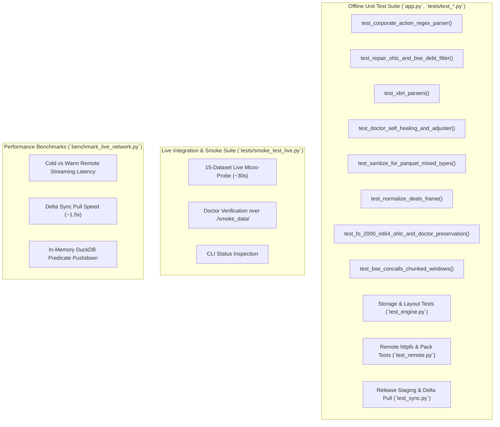

# bfinance-datalake: Developer & Testing Guide

This document specifies the testing architecture, quality assurance protocols, invariant validation checks, performance benchmarks, and contribution guidelines for **`bfinance-datalake`**.

---

## 1. Testing Framework & Philosophy

`bfinance-datalake` adheres to a strict testing philosophy:
1. **Zero External Network Dependencies for CI Unit Tests**: Core parsing, deduplication, atomic writes, DAG rename traversals, self-healing repairs, and mathematical backward adjustments must execute offline in under 5 seconds.
2. **Deterministic Invariant Validation**: Financial data must satisfy non-negotiable physical and market invariants (e.g., $\text{High} \ge \max(\text{Open}, \text{Close})$, $0 \le \text{PromoterPct} \le 100\%$, positive share counts).
3. **Cross-Platform Handle Safety**: Tests must explicitly verify that file replacements, in-memory buffers, and SQLite sessions never cause `PermissionError` file locks on Windows.
4. **Empirical Live Probes**: Live network probes against official exchange endpoints are segregated into dedicated smoke test suites that output to temporary sandboxes (`./smoke_data/`).



---

## 2. Test Execution Commands

### 2.1. Run the Complete Offline Verification Suite
Executes all 13 offline test suites via `app.py`:
```bash
uv run python app.py
```
Or via standard `unittest`:
```bash
uv run python -m unittest discover -s tests -p "test_*.py" -v
```

### 2.2. Run the Live 15-Dataset Smoke Test
Fetches a mini-slice from all 15 live upstream feeds into an isolated `./smoke_data/` directory and audits the output via `LakeDoctor`:
```bash
uv run python tests/smoke_test_live.py
```
Inspect the resulting smoke lake:
```bash
uv run datalake --data-dir ./smoke_data status
uv run datalake --data-dir ./smoke_data doctor
```

### 2.3. Run the Network Latency & Delta Sync Benchmark
Measures live HTTP range retrieval speeds, pack slice latencies, and delta sync pull times:
```bash
uv run python benchmark_live_network.py
```

---

## 3. Detailed Test Suites Walkthrough

### 3.1. Corporate Action Regex Parser Tests
**Source:** `tests/test_datalake_offline.py` $\to$ `test_corporate_action_regex_parser()`
- **Cash Dividends**: Validates parsing of `DIVIDEND RS 5.50 PER SHARE`, `INTEREST RS 1.25`, and multiple dividends in a single clause.
- **Percentage Dividends**: Verifies that percentage dividends (`DIVIDEND 250%`) are accurately converted to Rupees using the detected or provided face value:
  $$\text{Dividend} = 2.50 \times 10.0 = 25.0$$
- **Stock Splits**: Tests `SPLIT FROM RS 10 TO RS 2`, ensuring `SplitFromFV = 10.0`, `SplitToFV = 2.0`, and `ShareMultiplier = 5.0`.
- **Bonus Issues**: Tests `BONUS 1:1` and `BONUS 2:1`, verifying `ShareMultiplier = (BonusNew + BonusHeld) / BonusHeld`.
- **Non-Equity Filtering**: Verifies that announcements regarding debentures, warrants, or preference shares are tagged as `SKIP_NON_EQUITY`.

### 3.2. OHLC Repair & BSE Debt Filter Tests
**Source:** `tests/test_datalake_offline.py` $\to$ `test_repair_ohlc_and_bse_debt_filter()`
- **Zero Open Prices**: Injects legacy 1995 rows where `Open = 0.0` and asserts that `repair_ohlc()` replaces it with `PrevClose` or `Close`.
- **Swapped High/Low**: Injects corrupt rows where `High < Low` and asserts that `repair_ohlc()` swaps the values to restore monotonic bounds.
- **Envelope Invariant**: Confirms that $\text{High} \ge \max(\text{Open}, \text{Close})$ and $\text{Low} \le \min(\text{Open}, \text{Close})$.
- **BSE Debt Stripping**: Injects Group `G` (government gilts) and Group `F` corporate bonds with `INE` ISINs and verifies that `filter_bse_equity_only()` strips them completely.

### 3.3. Ind-AS Financial & Shareholding XBRL Tests
**Source:** `tests/test_datalake_offline.py` $\to$ `test_xbrl_parsers()`
- **Ind-AS Balance Sheet & P&L**: Constructs synthetic Ind-AS XML containing `RevenueFromOperations`, `ProfitLossForPeriod`, `BasicEarningsLossPerShare...`, and instant balance sheet elements (`Assets`, `EquityShareCapital`, `BorrowingsCurrent`).
- **Context Classification**: Verifies that 90-day intervals are classified as `Quarterly`, 365-day intervals as `Annual`, and instant elements as `Instant`.
- **Instant Fact Stitching**: Confirms that instant balance sheet items are stitched into the duration P&L record matching `PeriodEnd`.
- **Promoter Pledge & Named Holders**: Constructs shareholding XML and validates extraction of `PromoterPledgedPct`, `MutualFundsPct`, `FPI_Pct`, and $>1\%$ named shareholders.

### 3.4. Self-Healing Doctor & OHLCV Adjuster Tests
**Source:** `tests/test_datalake_offline.py` $\to$ `test_doctor_self_healing_and_adjuster()`
- **Orphaned File Sweeping**: Creates dummy `.tmp` files and confirms that `LakeDoctor` removes them.
- **Truncated Date Purging**: Writes a synthetic Parquet partition where a date has only 5 rows (below the 200-row threshold) and verifies that the doctor purges that date.
- **Backward Price Adjustment**: Simulates a 2:1 stock split and ₹10 cash dividend. Verifies that historical `Adj Close` matches theoretical backward multipliers.
- **Demerger Discovery**: Tests unannounced demergers where `PrevClose` drops significantly on adjacent trading days and confirms that the adjuster scales prices smoothly.

### 3.5. Parquet Sanitization & Numeric Precision Tests
**Source:** `tests/test_datalake_offline.py` $\to$ `test_sanitize_for_parquet_mixed_types()`
- Injects string representations (`"10.5"`, `"1,250.00"`, `"-"`, `None`) into numeric float columns (`DividendPerShareRs`, `SplitFromFV`, `Volume`).
- Asserts that `sanitize_for_parquet()` coerces all values to `float64` without throwing serialization errors.
- Confirms that `ShareMultiplier` nulls default to `1.0`.

### 3.6. Engine & Remote Tests
**Source:** `tests/test_engine.py` & `tests/test_remote.py`
- **Crosswalk Resolution**: Asserts that `lake.resolve("RELIANCE")`, `lake.resolve("500325")`, and `lake.resolve("INE002A01018")` resolve to the identical `SecurityIdentity`.
- **Ticker Rename DAG**: Confirms that querying `INFOSYSTCH` resolves to modern `INFY`.
- **DuckDB SQL Interface**: Runs analytical SQL queries (`lake.sql("SELECT COUNT(*) FROM equities_nse")`).
- **Zero-Disk Remote Queries**: Mocks GitHub Release endpoints and tests `RemoteLakeClient` byte-range querying and packfile slicing.

---

## 4. Performance Benchmarks

Benchmark metrics measured by `benchmark_live_network.py` across live GitHub Releases (`esconer/bfinance-datalake`):

| Operation | Protocol / Mechanism | Typical Latency | Data Transferred |
| :--- | :--- | :---: | :---: |
| **Local Single-Stock 30Y History** | In-Memory PyArrow Predicate Pushdown (`UnifiedLakeEngine`) | **1.2 – 3.5 ms** | 0 KB (NVMe / RAM) |
| **Local Multi-Symbol Download (50 Stocks)** | Vectorized Annual Partition Scan | **45 – 90 ms** | Read from local disk |
| **Remote Single-Stock History (Cold)** | HTTP Byte-Range Slice (`RemoteLakeClient` Pack Path) | **110 – 180 ms** | ~130 KB |
| **Remote Single-Stock History (Warm Repeat)** | RAM-Cached Index + HTTP Range Slice | **85 – 120 ms** | ~130 KB |
| **Remote Company Dossier (8 Tables)** | Single Byte-Range Query (`by_ticker__nse_dossier.pack`) | **130 – 190 ms** | ~45 KB |
| **Remote Market Screener (Latest Snapshot)** | HTTP Range over `snapshots__market_screener_latest.parquet` | **120 – 160 ms** | ~400 KB |
| **Remote SQL Aggregation (Full Year)** | DuckDB `httpfs` Remote Parquet Query | **350 – 550 ms** | ~2 – 4 MB |
| **Local Delta Sync (`datalake pull`)** | SHA-256 Manifest Comparison + Changed Partitions Pull | **~1.5 seconds** | Only changed daily deltas |

---

## 5. Contributing & Development Guidelines

### 5.1. Environment Setup
The project uses `uv` for fast, reproducible dependency management:
```bash
# 1. Clone repository
git clone https://github.com/esconer/bfinance-datalake.git
cd bfinance-datalake

# 2. Sync virtual environment and install all dependencies
uv sync

# 3. Verify installation by running test suite
uv run python app.py
```

### 5.2. Code Style & Formatting
- **Python Version**: Compatible with Python 3.10+.
- **Type Annotations**: All functions and method signatures must include strict type annotations (`from __future__ import annotations`).
- **Docstrings & Comments**: Maintain existing docstrings and inline explanatory comments detailing market mechanics, regulatory cutovers, and exchange anomalies.
- **Deterministic Imports**: Keep standard library imports, third-party imports (`pandas`, `numpy`, `pyarrow`, `duckdb`, `curl_cffi`), and internal imports organized cleanly.
- **Windows File Safety**: Always wrap Parquet reads via `read_table_safe()` and writes via `write_parquet_atomic()`. Never call `pd.read_parquet("path.parquet")` directly in core pipelines without buffer protection.
