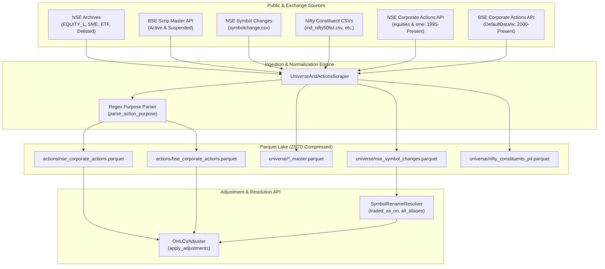

# Corporate Universe, Security Masters & Actions Integration

## Overview

In quantitative finance and algorithmic backtesting, historical price data is meaningless without an institutional-grade corporate universe framework:
1. **Survivorship Bias**: Filtering exclusively for companies currently listed guarantees artificially inflated backtest returns. Historical research must encompass **delisted securities**, **SME transitions**, and **suspended scrips**.
2. **Ticker & Symbol Instability**: Indian equities frequently undergo corporate renames, demergers, and brand identity shifts (e.g., `INFOSYSTCH` $\rightarrow$ `INFY`, `MINDTREE` $\rightarrow$ `LTIM`, `ZOMATO` $\rightarrow$ `ETERNAL`). A strategy executing historical queries on modern tickers fails without bidirectional temporal symbol resolution.
3. **Point-In-Time (PIT) Index Membership**: Evaluating index momentum or benchmark-relative performance requires knowledge of which companies belonged to an index on any historical date.
4. **Corporate Action Distortions**: Unadjusted prices exhibit artificial cliffs when stock splits, bonus issues, and major cash dividends take effect.

`bfinance-datalake` addresses these requirements through four interconnected systems:
* **Exchange Security Masters**: Canonical master files from NSE and BSE covering Active, Suspended, SME, ETF, and Delisted universes.
* **Symbol Rename Resolver (`SymbolRenameResolver`)**: A graph-based temporal resolver that tracks ticker rename chains over 30 years.
* **Point-in-Time Index Constituents (`nifty_constituents_pit.parquet`)**: Versioned snapshots of active constituents for major Nifty indices.
* **Corporate Actions & Price Adjuster (`UniverseAndActionsScraper` + `OHLCVAdjuster`)**: Deterministic regex extraction of splits, bonuses, dividends, and rights issues, coupled with backward-adjusted price series computation (`Adj Close`).

---

## Architecture & Data Flow



---

## Endpoint Specifications

### 1. Exchange Security Masters (NSE Archives)

Security master files are retrieved daily from the static archive distribution network of the National Stock Exchange:

| Security Master Dataset | Target Path | Official URL | Update Cadence |
| :--- | :--- | :--- | :---: |
| **NSE Mainboard Equity** | `universe/nse_equity_master.parquet` | `https://nsearchives.nseindia.com/content/equities/EQUITY_L.csv` | Daily |
| **NSE SME Platform** | `universe/nse_sme_master.parquet` | `https://nsearchives.nseindia.com/content/equities/SME_EQUITY_L.csv` | Daily |
| **NSE ETFs** | `universe/nse_etf_master.parquet` | `https://nsearchives.nseindia.com/content/equities/eq_etfseclist.csv` | Daily |
| **NSE Delisted Stocks** | `universe/nse_delisted_master.parquet`| `https://nsearchives.nseindia.com/content/equities/delisted.csv` | Daily |
| **NSE Symbol Changes** | `universe/nse_symbol_changes.parquet` | `https://nsearchives.nseindia.com/content/equities/symbolchange.csv` | Daily |

#### Request Headers:
```http
User-Agent: Mozilla/5.0 (Windows NT 10.0; Win64; x64) AppleWebKit/537.36 (KHTML, like Gecko) Chrome/124.0.0.0 Safari/537.36
Accept: text/csv,text/plain,application/xhtml+xml,application/xml;q=0.9,*/*;q=0.8
Connection: keep-alive
```

---

### 2. BSE Scrip Master API

The Bombay Stock Exchange provides a JSON API exposing all scrips categorized by listing status:

```http
GET https://api.bseindia.com/BseIndiaAPI/api/ListofScripData/w?Group=&Scripcode=&industry=&segment=Equity&status={Active|Suspended}
Referer: https://www.bseindia.com/
Accept: application/json, text/plain, */*
```

* Active Scrips: ~5,122 securities
* Suspended Scrips: ~1,224 securities

---

### 3. Point-In-Time Index Constituent Lists

Current member lists for all primary Nifty index families are archived daily with an explicit snapshot timestamp:

```http
GET https://nsearchives.nseindia.com/content/indices/ind_{index_key}list.csv
```
* **NIFTY 50**: `https://nsearchives.nseindia.com/content/indices/ind_nifty50list.csv`
* **NIFTY NEXT 50**: `https://nsearchives.nseindia.com/content/indices/ind_niftynext50list.csv`
* **NIFTY 100**: `https://nsearchives.nseindia.com/content/indices/ind_nifty100list.csv`
* **NIFTY 200**: `https://nsearchives.nseindia.com/content/indices/ind_nifty200list.csv`
* **NIFTY 500**: `https://nsearchives.nseindia.com/content/indices/ind_nifty500list.csv`
* **NIFTY MIDCAP 150**: `https://nsearchives.nseindia.com/content/indices/ind_niftymidcap150list.csv`

---

### 4. Exchange Corporate Actions APIs

#### A. NSE Corporate Actions API
```http
GET https://www.nseindia.com/api/corporates-corporateActions?index={equities|sme}&from_date=01-01-{year}&to_date=31-12-{year}
Referer: https://www.nseindia.com/companies-listing/corporate-filings-financial-results
Accept: application/json, text/plain, */*
```
*(Requires session initialization / cookie priming via `https://www.nseindia.com`).*

#### B. BSE Corporate Actions API
```http
GET https://api.bseindia.com/BseIndiaAPI/api/DefaultData/w?scripcode=&Fdate={year}0101&TDate={year}1231&Purposecode=&ddlcategorys=E&ddlindustrys=&segment=0&strSearch=S
Referer: https://www.bseindia.com/
Accept: application/json, text/plain, */*
```

---

## Data Schemas & Live Sample Records

### 1. NSE Equity Master (`EQUITY_L.csv`)

| Column Name | Type | Description | Sample Value |
| :--- | :---: | :--- | :--- |
| `SYMBOL` | `string` | NSE Trading Ticker | `20MICRONS` |
| `NAME OF COMPANY` | `string` | Registered Corporate Entity Name | `20 Microns Limited` |
| `SERIES` | `string` | Trading Series (`EQ`, `BE`, `SM`) | `EQ` |
| `DATE OF LISTING` | `string` | Initial listing date (`DD-MON-YYYY`)| `06-OCT-2008` |
| `PAID UP VALUE` | `int64` | Paid-up capital per share | `5` |
| `MARKET LOT` | `int64` | Standard trading quantity lot | `1` |
| `ISIN NUMBER` | `string` | 12-character International ISIN | `INE144J01027` |
| `FACE VALUE` | `float64`| Face value of share in INR | `5.0` |

---

### 2. NSE Symbol Changes (`symbolchange.csv`)

Tracks every official symbol change across the exchange history:

| Column Name | Type | Description | Live Verified Sample |
| :--- | :---: | :--- | :--- |
| `CompanyName` | `string` | Full corporate name | `LTIMindtree Limited` |
| `OldSymbol` | `string` | Former trading ticker | `MINDTREE` |
| `NewSymbol` | `string` | Successor trading ticker | `LTIM` |
| `ChangeDate` | `datetime64[ns]` | Effective transition date | `2022-11-23` |

Other prominent verified changes:
* `INFOSYSTCH` $\rightarrow$ `INFY` (`2011-06-29`)
* `ZOMATO` $\rightarrow$ `ETERNAL` (`2024-08-01`)
* `UTIBANK` $\rightarrow$ `AXISBANK` (`2007-07-30`)

---

### 3. BSE Scrip Master (`bse_scrip_master.parquet`)

```json
{
  "SCRIP_CD": "500002",
  "Scrip_Name": "ABB India Ltd",
  "Status": "Active",
  "GROUP": "A",
  "FACE_VALUE": "2.00",
  "ISIN_NUMBER": "INE117A01022",
  "INDUSTRY": null,
  "scrip_id": "ABB",
  "Segment": "Equity",
  "NSURL": "https://www.bseindia.com/stock-share-price/abb-india-ltd/abb/500002/",
  "Issuer_Name": "ABB India Limited",
  "Mktcap": "135684.93"
}
```

---

### 4. NSE Corporate Actions Payload

```json
{
  "symbol": "GODREJIND",
  "series": "EQ",
  "isin": "INE233A01035",
  "comp": "Godrej Industries Limited",
  "faceVal": "1",
  "subject": "Bonus 1 : 1250",
  "exDate": "05-Jan-2015",
  "recDate": "06-Jan-2015",
  "bcStartDate": "-",
  "bcEndDate": "-",
  "ndStartDate": "-",
  "ndEndDate": "-",
  "caBroadcastDate": null
}
```

---

### 5. BSE Corporate Actions Payload

```json
{
  "scrip_code": 511092,
  "short_name": "JMDVL",
  "long_name": "JMD Ventures Ltd",
  "Ex_date": "01 Jan 2015",
  "exdate": "20150101",
  "Purpose": "Bonus issue 1:1",
  "RD_Date": "02 Jan 2015",
  "BCRD_FROM": "",
  "BCRD_TO": "",
  "ND_START_DATE": "26 Dec 2014",
  "ND_END_DATE": "01 Jan 2015",
  "payment_date": ""
}
```

---

## Regex Purpose Parser & Action Engine

Exchange corporate action subjects are unstructured human-typed strings with varying formats across 30 years. The [`parse_action_purpose()`](file:///e:/dev/code/bfinance-datalake/src/datalake/scrapers/universe_actions.py#L41-L92) function normalizes raw descriptions into numeric parameters.

### Parsed Output Structure
```python
{
    "ActionType": "SPLIT" | "BONUS" | "DIVIDEND" | "RIGHTS" | "DEMERGER" | "BUYBACK" | "SKIP_NON_EQUITY" | "OTHER",
    "DividendPerShareRs": float | None,
    "BonusNew": float | None,
    "BonusHeld": float | None,
    "SplitFromFV": float | None,
    "SplitToFV": float | None,
    "ShareMultiplier": float,  # Default 1.0
}
```

### Regex Classification Rules

| Action Type | Extraction Pattern | Example Input | Extracted Fields & Multiplier |
| :--- | :--- | :--- | :--- |
| **Stock Split** | `(?:split\|sub[-\s]*division).*?(?:from\s+)?(?:rs\.?\|re\.?\|₹\|inr)?\s*(\d+(?:\.\d+)?)\s*(?:/-)?(?:\s*(?:per\s+share\|each))?\s*(?:to\|into)\s*(?:rs\.?\|re\.?\|₹\|inr)?\s*(\d+(?:\.\d+)?)` | `Face Value Split (Sub-Division) - From Rs 10/- Per Share To Re 1/- Per Share` | `SplitFromFV: 10.0`<br>`SplitToFV: 1.0`<br>`ShareMultiplier: 10.0` |
| **Bonus Issue** | `\bbonus\b.*?(\d+)\s*:\s*(\d+)` | `Bonus issue 1:1` | `BonusNew: 1.0`<br>`BonusHeld: 1.0`<br>`ShareMultiplier: 2.0` |
| **Cash Dividend** | `\b(?:dividend\|div\|interest\|income\s+distribution\|dist)\b.*?(?:rs\.?\|re\.?\|₹\|inr)\s*[-:]?\s*(\d+(?:\.\d+)?)` | `Final Dividend - Rs. - 12.5000` | `DividendPerShareRs: 12.5`<br>`ShareMultiplier: 1.0` |
| **Compound Dividend** | Multiple clauses parsed sequentially | `Special Dividend - Rs 5 / Interim Dividend - Rs 10` | `DividendPerShareRs: 15.0`<br>`ShareMultiplier: 1.0` |
| **Rights Issue** | `\brights?\b.*?(\d+)\s*:\s*(\d+)` | `Right Issue of Equity Shares 1:5` | `ActionType: "RIGHTS"`<br>`ShareMultiplier: 1.0` |
| **Non-Equity Exclusion**| `\b(?:debenture\|ncd\|ccd\|ccps\|preference\|ncrps\|dvr\|warrant\|bond)\b` | `Bonus issue 1:1 on Non-Convertible Debentures (NCD)` | `ActionType: "SKIP_NON_EQUITY"`<br>`ShareMultiplier: 1.0` |

---

## Symbol Rename Resolution Engine

Historical ticker tracking is performed by [`SymbolRenameResolver`](file:///e:/dev/code/bfinance-datalake/src/datalake/symbols.py):

### Directed Acyclic Graph (DAG) Model
The resolver builds two directed adjacency maps from `universe/nse_symbol_changes.parquet`:
* **Backward Edges (`_back_edges`)**: Maps modern symbol $\rightarrow$ historical predecessors sorted in descending chronological order:
  $$\text{NewSymbol} \xrightarrow{\tau_{change}} \text{OldSymbol}$$
* **Forward Edges (`_fwd_edges`)**: Maps historical symbol $\rightarrow$ successor symbols:
  $$\text{OldSymbol} \xrightarrow{\tau_{change}} \text{NewSymbol}$$

### Core Resolution Methods

1. **`traded_as_on(current_symbol: str, target_date: date) -> str`**:  
   Walks backward through time. If `target_date < ChangeDate`, steps to the active predecessor symbol on that date.
   * Example: `resolver.traded_as_on("LTIM", date(2021, 5, 1))` $\rightarrow$ `"MINDTREE"`
   * Example: `resolver.traded_as_on("LTIM", date(2023, 1, 1))` $\rightarrow$ `"LTIM"`
   * Example: `resolver.traded_as_on("INFY", date(2005, 1, 1))` $\rightarrow$ `"INFOSYSTCH"`

2. **`all_aliases(symbol: str) -> list[str]`**:  
   Resolves the complete family of names across the entire corporate lifetime (e.g. `['LTIM', 'MINDTREE']`). Used when merging corporate actions across history so that actions announced under former tickers apply seamlessly to historical OHLCV.

---

## Backward OHLCV Price Adjustment Mathematics

The [`OHLCVAdjuster`](file:///e:/dev/code/bfinance-datalake/src/datalake/adjuster.py) computes backward dividend- and split-adjusted prices (`Adj Close`) according to CRSP / Yahoo Finance standard institutional methodology:

### 1. Cumulative Split Factor ($F_{split, t}$)
For a series of stock splits and bonus issues with share multipliers $M_{\tau}$ occurring at ex-dates $\tau > t$:

$$F_{split, t} = \prod_{\tau > t} \frac{1}{M_{\tau}}$$

At the latest available trading date $T$, $F_{split, T} = 1.0$. Prior to a 1:1 bonus issue ($M = 2.0$), $F_{split} = 0.5$.

### 2. Dividend Step Adjustment Factor ($D_{step, \tau}$)
On ex-dividend date $\tau$ with dividend per share $Div_{\tau}$ and previous unadjusted close $Close_{\tau-1}$:

$$D_{step, \tau} = 1.0 - \frac{Div_{\tau}}{Close_{\tau-1}} \quad \text{for } 0 < Div_{\tau} < Close_{\tau-1}$$

The cumulative dividend discount factor for any prior date $t$ is:

$$F_{div, t} = \prod_{\tau > t} D_{step, \tau}$$

### 3. Total Price Adjustment & Adjusted Volume

$$\text{Adj Close}_t = \text{round}\left(\text{Close}_t \times F_{split, t} \times F_{div, t}, \, 4\right)$$

When `auto_adjust=True` is selected:
$$\text{Adj Open}_t = \text{Open}_t \times F_{split, t} \times F_{div, t}$$
$$\text{Adj High}_t = \text{High}_t \times F_{split, t} \times F_{div, t}$$
$$\text{Adj Low}_t = \text{Low}_t \times F_{split, t} \times F_{div, t}$$
$$\text{Adj Volume}_t = \text{round}\left(\frac{\text{Volume}_t}{F_{split, t}}\right)$$

---

## Historical Boundaries ("From Where to Where")

Live testing confirmed the availability windows for universe masters and corporate action databases:

| Dataset | Storage Path | Earliest Date | Latest Date | Live Probe Evidence |
| :--- | :--- | :---: | :---: | :--- |
| **NSE Equity Master** | `universe/nse_equity_master.parquet` | Snapshot | Current | 2,620 active equity listings. |
| **NSE SME Master** | `universe/nse_sme_master.parquet` | Snapshot | Current | Active SME listings. |
| **BSE Scrip Master** | `universe/bse_scrip_master.parquet` | Snapshot | Current | 5,122 active + 1,224 suspended scrips. |
| **NSE Symbol Changes** | `universe/nse_symbol_changes.parquet` | **`1994-01-01`** | Current | 1,078 recorded ticker transitions. |
| **PIT Nifty Constituents**| `universe/nifty_constituents_pit.parquet`| Daily Snapshots | Current | Tracked across Nifty 50, 100, 200, 500, Midcap 150. |
| **NSE Corporate Actions**| `actions/nse_corporate_actions.parquet` | **`1995-01-04`** | Current | **1995**: 81 actions<br>**2005**: 829 actions<br>**2015**: 1,911 actions<br>**2024**: 2,693 actions |
| **NSE SME Actions** | `actions/nse_corporate_actions.parquet` | **`2013-01-01`** | Current | SME segment launched 2012/2013. |
| **BSE Corporate Actions**| `actions/bse_corporate_actions.parquet` | **`2000-06-30`** | Current | **2000**: 146 actions<br>**2005**: 250 actions<br>**2015**: 1,567 actions<br>**2024**: 2,593 actions |

---

## Usage in `bfinance-datalake`

### 1. Ingestion via CLI

```bash
# Sync security masters, symbol changes, and PIT constituents
uv run datalake daily --lookback 7

# Full historical corporate actions backfill (1995 to Present)
uv run datalake backfill --start 1995-01-01 --end 2026-11-01
```

### 2. Python API: Resolving Historical Tickers & Applying Adjustments

```python
from datetime import date
from datalake.adjuster import OHLCVAdjuster
from datalake.symbols import SymbolRenameResolver
from datalake.storage import read_table_safe

# 1. Resolve Historical Symbol
resolver = SymbolRenameResolver.from_lake("./data")
historical_sym = resolver.traded_as_on("LTIM", date(2021, 10, 1))
print(f"LTIM traded as: {historical_sym}")  # Outputs: MINDTREE

# 2. Get All Aliases
aliases = resolver.all_aliases("LTIM")
print(f"All aliases: {aliases}")  # Outputs: ['LTIM', 'MINDTREE']

# 3. Apply Backward Adjustments to Raw OHLCV
adjuster = OHLCVAdjuster("./data")
raw_df = read_table_safe("./data/equities/nse_cm_2024.parquet")
rel_raw = raw_df[raw_df["Symbol"] == "RELIANCE"]

# Apply dividend & bonus adjustments
adj_df = adjuster.apply_adjustments(rel_raw, "RELIANCE", exchange="NSE", auto_adjust=True)
print(adj_df[["Date", "Open", "High", "Low", "Close", "Adj Close", "Dividends", "Stock Splits"]].tail())
```

### 3. Live Proof: Reliance Industries 1:1 Bonus (`2024-10-28`)
Reliance Industries executed a 1:1 bonus issue on `2024-10-28`. 
* Unadjusted raw close on `2024-10-25`: `~2,656.00`
* When processed through `OHLCVAdjuster`:
  - `Stock Splits` on `2024-10-28` is flagged as `2.0`
  - Cumulative split factor prior to `2024-10-28` is evaluated as $0.5$
  - The calculated `Adj Close` on `2024-10-25` is seamlessly adjusted to `~1,328.00`, eliminating the artificial $50\%$ drop.
