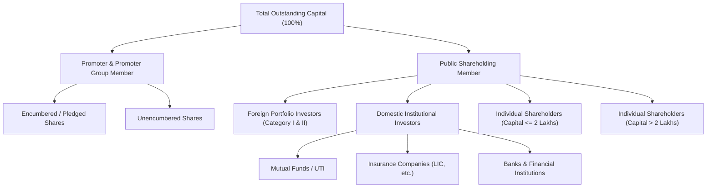

# Ind-AS XBRL Fundamentals & Shareholding Data Integration

## Overview

`bfinance-datalake` features an automated corporate disclosures pipeline that ingests, parses, and standardizes:
1. **Ind-AS XBRL Financial Results** (Quarterly, Half-Yearly, Nine-Months, and Annual P&L, Balance Sheet, and Cash Flows across Industrial and Banking taxonomies).
2. **Shareholding Pattern (SHP) & Promoter Pledge** (Promoter %, Pledged Shares & %, Foreign Portfolio Investors/FPI %, Domestic Institutions/Mutual Funds %, Insurance %, Retail %, and named institutional holders >1% such as LIC).

The pipeline combines official unauthenticated and session-primed REST APIs from the National Stock Exchange of India (**NSE**) and the Bombay Stock Exchange (**BSE**), XML/iXBRL parsers powered by `lxml`, and a resilient fallback mechanism that extracts structured financial line items directly from JSON payloads when raw XML files are unavailable.

---

## 1. Ind-AS XBRL Financial Results

### 1.1 Endpoint Specification

#### Market-Wide Equities Batch
```http
GET https://www.nseindia.com/api/corporates-financial-results?index=equities&period={period}
```
* **Required Parameter `period`**: Must be either `Quarterly` or `Annual`. Omitting `period` results in empty or invalid responses.
* **Volume**: Returns the complete market-wide filing manifest for recent earnings cycles (~3,800+ quarterly filings across all listed equities in a single request).

#### Symbol-Specific Full History
```http
GET https://www.nseindia.com/api/corporates-financial-results?index=equities&symbol={symbol}&period={period}
```
* **Parameters**:
  * `symbol`: NSE Equity Symbol (e.g., `RELIANCE`, `TCS`, `HDFCBANK`, `INFY`).
  * `period`: `Quarterly` or `Annual`.
* **Historical Reach**: Returns the complete filing history for that scrip dating back from recent quarters to **2005** (e.g., 130 quarterly filings for Reliance, 144 for Infosys, 103 for HDFC Bank).

#### Request Headers & TLS Impersonation
```http
User-Agent: Mozilla/5.0 (Windows NT 10.0; Win64; x64) AppleWebKit/537.36 (KHTML, like Gecko) Chrome/124.0.0.0 Safari/537.36
Accept: application/json, text/plain, */*
Accept-Language: en-US,en;q=0.9
Accept-Encoding: gzip, deflate
Referer: https://www.nseindia.com/companies-listing/corporate-filings-financial-results
```
*(Requires HTTP session priming against `https://www.nseindia.com` using `curl_cffi` Chrome 124 TLS impersonation to obtain exchange session cookies).*

---

### 1.2 XML Taxonomy & Architecture

Filing records in the API provide an `xbrl` field pointing to raw XML files hosted on `https://nsearchives.nseindia.com/corporate/xbrl/`.

#### Supported Taxonomies

| Taxonomy | File Prefix Example | Root Namespace URI | Primary Industry Sectors |
| :--- | :--- | :--- | :--- |
| **Industrial / Commercial** (`in-bse-fin`) | `INDAS_117298_1348254_16012025082021.xml` | `http://www.bseindia.com/xbrl/fin/2020-03-31/in-bse-fin` | Manufacturing, IT, Energy, FMCG, Pharma, Telecom |
| **Banking & Financials** (`in-bse-bank`) | `BANKING_117525_1359016_23012025122721.xml` | `http://www.bseindia.com/xbrl/fin/2019-09-30/in-bse-fin` | Commercial Banks, Small Finance Banks, NBFCs |

#### Context Disambiguation & Duration Mapping

In Ind-AS XBRL instance documents, contexts define whether a metric represents a duration (P&L or Cash Flow) or an instant snapshot (Balance Sheet). `bfinance-datalake` parses contexts without explicit dimension members (`explicitMember`) and classifies duration spans by calendar days:

$$\text{Duration Days} = \text{endDate} - \text{startDate}$$

* **Quarterly**: $70 \le \text{Days} \le 105$
* **Half-Yearly**: $165 \le \text{Days} \le 200$
* **Nine-Months**: $255 \le \text{Days} \le 290$
* **Annual**: $345 \le \text{Days} \le 380$
* **Instant Snapshot**: Instant balance sheet figures (where `startDate` is null) are indexed by `endDate` and automatically merged into duration records sharing the same period end.

---

### 1.3 Financial Metrics Schema

All monetary line items are converted from raw Indian Rupees into **Crores (`_Cr`)** by dividing by $10^7$ (`1e7`), rounded to 4 decimal places. Per-share figures (`_Rs`) and ratios (`_Pct`) remain unscaled.

#### Standardized Field Mapping

| Datalake Field | Taxonomy Tag | Description | Unit / Scale |
| :--- | :--- | :--- | :---: |
| `Sales_Cr` | `RevenueFromOperations` / `InterestEarned` | Top-line turnover (aliased to Interest Earned for banks) | INR Crores |
| `OtherIncome_Cr` | `OtherIncome` / `OtherOperatingIncomeBanking` | Non-operating or ancillary operating income | INR Crores |
| `TotalIncome_Cr` | `Income` | Total gross revenue from operations + other income | INR Crores |
| `MaterialCost_Cr` | `CostOfMaterialsConsumed` | Raw material input expenses | INR Crores |
| `StockInTradePurchases_Cr` | `PurchasesOfStockInTrade` | Finished goods purchased for resale | INR Crores |
| `EmployeeCost_Cr` | `EmployeeBenefitExpense` | Salaries, wages, PF, and staff welfare | INR Crores |
| `Interest_Cr` | `FinanceCosts` / `InterestExpended` | Borrowing costs and bank interest paid | INR Crores |
| `Depreciation_Cr` | `DepreciationDepletionAndAmortisationExpense` | Amortization of tangibles and intangibles | INR Crores |
| `OtherExpenses_Cr` | `OtherExpenses` | Manufacturing, admin, and selling overheads | INR Crores |
| `PBT_Cr` | `ProfitBeforeTax` | Profit before exceptional items and tax | INR Crores |
| `Tax_Cr` | `TaxExpense` | Current and deferred tax provision | INR Crores |
| `NetProfit_Cr` | `ProfitLossForPeriod` | Bottom-line Profit After Tax (PAT) | INR Crores |
| `BasicEPS_Rs` | `BasicEarningsLossPerShare...` | Basic earnings per share | INR |
| `DilutedEPS_Rs` | `DilutedEarningsLossPerShare...` | Diluted earnings per share | INR |
| `CashAndEquivalents_Cr` | `CashAndCashEquivalents` | Liquid cash and short-term bank balances | INR Crores |
| `TotalCashAndBank_Cr` | `CashAndCashEquivalents` + `BankBalanceOther...` | Consolidated cash and non-operating bank balances | INR Crores |
| `TotalBorrowings_Cr` | `BorrowingsNoncurrent` + `BorrowingsCurrent` | Total short-term and long-term debt | INR Crores |
| `TotalAssets_Cr` | `Assets` | Consolidated balance sheet footings | INR Crores |
| `Reserves_Cr` | `OtherEquity` | Retained earnings and reserves | INR Crores |
| `EquityCapital_Cr` | `EquityShareCapital` | Paid-up equity share capital | INR Crores |
| `OperatingCashFlow_Cr` | `CashFlowsFromUsedInOperatingActivities` | Cash generated from operations | INR Crores |
| `InvestingCashFlow_Cr` | `CashFlowsFromUsedInInvestingActivities` | Capital expenditure and investment cash flows | INR Crores |
| `FinancingCashFlow_Cr` | `CashFlowsFromUsedInFinancingActivities` | Debt issuance/repayment and dividends paid | INR Crores |
| `GrossNPA_Cr` | `GrossNonPerformingAssets` | Gross non-performing loans (Banking) | INR Crores |
| `NetNPA_Cr` | `NetNonPerformingAssets` | Net non-performing loans (Banking) | INR Crores |
| `GrossNPA_Pct` | `PercentageOfGrossNPA` | Gross NPA ratio (Banking) | % |
| `NetNPA_Pct` | `PercentageOfNetNPA` | Net NPA ratio (Banking) | % |
| `CapitalAdequacyRatio_Pct`| `CapitalAdequacyRatio` | Basel III CRAR percentage (Banking) | % |

---

### 1.4 JSON Direct Fallback Architecture

Before the adoption of Ind-AS XBRL filing mandates, or when an exchange disclosure record points to a placeholder URL (`.../corporate/xbrl/-`), the datalake does not discard the filing. Instead, it extracts financial figures directly from the parent JSON payload:

```json
{
  "symbol": "RELIANCE",
  "companyName": "Reliance Industries Limited",
  "fromDate": "01-Jan-2015",
  "toDate": "31-Mar-2015",
  "period": "Quarterly",
  "consolidated": "Non-Consolidated",
  "re_net_sale": "67372.00",
  "re_pro_loss_bef_tax": "7200.00",
  "re_net_profit": "5511.00",
  "re_basic_eps_for_cont_dic_opr": "17.03",
  "xbrl": "https://nsearchives.nseindia.com/corporate/xbrl/-"
}
```

The fallback parser (`_extract_json_financial_row`):
1. Detects `xbrl` URLs ending in `/-` or missing `.xml` extensions.
2. Reads Lakhs-denominated fields (`income`, `re_net_sale`, `netProfit`, `re_net_profit`, `profitBeforeTax`, `re_pro_loss_bef_tax`).
3. Converts Lakhs to Crores by dividing by $100.0$.
4. Populates `Sales_Cr`, `PBT_Cr`, `NetProfit_Cr`, and `BasicEPS_Rs` directly into the normalized database.

---

## 2. Shareholding Pattern (SHP) & Promoter Pledge

### 2.1 Endpoint Specification

#### BSE Multi-Decade Shareholding History
```http
GET https://api.bseindia.com/BseIndiaAPI/api/Corp_Shareholding_ng/w?scripcode={scrip_code}&flag=0&indtype=
```
* **Parameters**: `scripcode` (BSE numerical Security Code, e.g. `500325` for Reliance, `532540` for TCS).
* **Headers**: `BSE_API_HEADERS` with session priming.
* **Coverage**: Returns **100+ continuous quarters** dating back to **2001**!
* **Key Fields in Response**:
  * `sQtrName`: Reporting period string (e.g., `"September 2026"`, `"June 2001"`).
  * `nqtrid`: BSE sequential quarter identifier (e.g., `"131.00&Flag=New"`).
  * `ese_p`: Promoter shareholding percentage.
  * `ese_np`: Public shareholding percentage.
  * `tot_no_shs`: Total outstanding equity shares.
  * `XBRLAttachment`: Relative path to raw XBRL XML or iXBRL HTML file (e.g., `"/XBRLFILES/SHPXBRLDataXML/500325_21102026154832_SP.html"`).

#### NSE Recent Shareholding Master
```http
GET https://www.nseindia.com/api/corporate-share-holdings-master?index=equities&symbol={symbol}
```
* **Parameters**: `symbol` (e.g., `RELIANCE`).
* **Coverage**: 20–24 quarters of rolling history (~5–6 years).
* **Key Fields**: `pr_and_prgrp` (Promoter %), `public_val` (Public %), `xbrl` (Full HTTPS URL to `SHP_*.xml`).

---

### 2.2 `in-bse-shp` Taxonomy & Parsing

Both BSE and NSE publish detailed shareholding structures adhering to the SEBI-mandated `in-bse-shp` taxonomy (e.g. `http://www.bseindia.com/xbrl/shp/2025-10-31/in-bse-shp`).

#### Category Extraction Hierarchy

The datalake parser (`XBRLScraper.parse_full_shp_xbrl`) inspects XML and iXBRL HTML trees, resolving dimension contexts to explicit member keys:



#### Parsed Metrics Summary

| Output Column | Source Context / Member | Description |
| :--- | :--- | :--- |
| `PromoterPct` | `ShareholdingOfPromoterAndPromoterGroupMember` | Total percentage held by promoters |
| `PromoterPledgedShares` | `...PromotersAreEncumberedUnderPledged` | Total number of promoter shares pledged as collateral |
| `PromoterPledgedPct` | `...SharesPledged...AsAPercentageOfTotal...` | Pledged shares as % of promoter holding or total equity |
| `PublicPct` | `PublicShareholdingMember` | Non-promoter public float percentage |
| `MutualFundsPct` | `MutualFundsOrUTIMember` / `MutualFundsMember` | Domestic mutual fund ownership percentage |
| `FPI_Pct` | `ForeignPortfolioInvestorsCategoryIMember` + `CategoryIIMember` | Institutional foreign portfolio investors percentage |
| `InsurancePct` | `InsuranceCompaniesMember` | Domestic insurance companies percentage |
| `RetailPct` | `ResidentIndividualsHolding...UpToTwoLakhsMember` | Small retail shareholders percentage |

#### Named Institutional Shareholders (>1% Holdings)

SEBI regulations mandate disclosure of the identity of any individual or institutional shareholder holding more than 1% of total equity. The datalake extracts these entities from typed dimension members:

```python
{
    "Symbol": "RELIANCE",
    "QuarterEnd": "30-SEP-2026",
    "CategoryMember": "InsuranceCompaniesMember",
    "HolderName": "LIFE INSURANCE CORPORATION OF INDIA",
    "PAN": "AAACL0582H",
    "Shares": 427845112,
    "PctOfTotal": 6.32,
    "PledgedShares": 0
}
```

---

## 3. Historical Boundaries ("From Where to Where")

Empirical live probes executed across multiple market cycles established the following data availability limits:

| Dataset | Exchange / Source | Earliest Available Date | Latest Available Date | Ingestion Granularity |
| :--- | :---: | :---: | :---: | :--- |
| **Ind-AS XBRL XMLs** | NSE & BSE Archives | **Q1 FY 2016-17 (01-Apr-2016)** | **Latest Reported Quarter** | Full line-item XML (Balance sheet, P&L, Cash Flow) |
| **Historical Financials (JSON)** | NSE API Fallback | **Q1 2005 (01-Apr-2005)** | **Latest Reported Quarter** | Core figures (Sales, PBT, Net Profit, EPS) |
| **Shareholding History (Base)** | BSE `Corp_Shareholding_ng` | **June 2001 (Quarter 30)** | **Latest Reported Quarter** | 100+ consecutive quarters (Promoter vs Public %) |
| **Shareholding XBRL / iXBRL** | BSE XBRL Attachment | **Q1 2006** | **Latest Reported Quarter** | Full breakdown (Pledge, FII, DII, MF, Insurance, >1% holders) |
| **NSE Shareholding Master** | NSE API | **Q3 2019 (30-Sep-2019)** | **Latest Reported Quarter** | 20–24 quarters rolling window |

---

## 4. Technical Constraints & Anti-Bot Protection

### 1. Akamai / Cloudflare Challenge Mitigation
Both `www.nseindia.com` and `api.bseindia.com` employ enterprise WAFs with JA3/TLS fingerprint inspection. Standard Python HTTP libraries (`urllib`, vanilla `requests`, unpatched `httpx`) are blocked with HTTP 403 Forbidden or DNS resolution timeouts.
* **Datalake Engine**: Uses `curl_cffi` with `impersonate="chrome124"` across all requests.
* **Session Priming**: Executes an initial handshake against exchange homepages to establish valid cookies (`nseappid`, cookies, session tokens) before querying API endpoints.

### 2. URL Extension Sanitization
NSE often lists filings with placeholder XBRL URLs such as:
`https://nsearchives.nseindia.com/corporate/xbrl/-`
Attempting to fetch this URL generates a 404 or hangs. The scraper's `_is_valid_xbrl_url` validation checks:
```python
def _is_valid_xbrl_url(url: str | None) -> bool:
    if not url:
        return False
    s = str(url).strip()
    if not s.startswith("http") or s.endswith("/-") or s.endswith("-"):
        return False
    return s.lower().endswith((".xml", ".html"))
```

### 3. Concurrency & Rate Limits
* Polite request delays (`0.15s` to `0.30s`) between symbol queries.
* Failed downloads automatically retry with exponential backoff ($1.5 \times 2^{\text{attempt}}$ seconds).

---

## 5. Storage Layout & Database Schemas

All datasets are saved as Snappy-compressed columnar Parquet files with deduplication keys enforced upon write:

### 1. `fundamentals/xbrl_financials.parquet`
* **Deduplication Key**: `["Symbol", "NatureOfReport", "PeriodType", "PeriodStart", "PeriodEnd"]`
* **Sort Key**: `["Symbol", "PeriodEnd", "PeriodType"]`

### 2. `shareholding/bse_shareholding_history.parquet`
* **Deduplication Key**: `["ScripCode", "QuarterId"]`
* **Sort Key**: `["ScripCode", "QuarterId"]`

### 3. `shareholding/nse_shareholding_summary.parquet`
* **Deduplication Key**: `["Symbol", "QuarterEnd"]`
* **Sort Key**: `["Symbol", "QuarterEnd"]`

### 4. `shareholding/named_shareholders.parquet`
* **Deduplication Key**: `["Symbol", "QuarterEnd", "CategoryMember", "HolderName"]`
* **Sort Key**: `["Symbol", "QuarterEnd", "PctOfTotal"]`

---

## 6. CLI Usage

### Sync Specific Blue-Chip Equities
```bash
uv run datalake xbrl --symbols RELIANCE,TCS,HDFCBANK,INFY,ITC --bse-scrips 500325,532540,500180,500209,500875
```

### Market-Wide Automated Ingestion
```bash
# Sync entire active universe across all NSE and BSE listed equities
uv run datalake xbrl --all-market

# Test run with first 50 companies
uv run datalake xbrl --all-market --limit 50
```

### Inspection via DuckDB / Python
```python
import duckdb

con = duckdb.connect()
# Query Reliance historical revenue and net profit
df_fin = con.execute("""
    SELECT Symbol, PeriodEnd, PeriodType, NatureOfReport, Sales_Cr, PBT_Cr, NetProfit_Cr, BasicEPS_Rs
    FROM 'data/fundamentals/xbrl_financials.parquet'
    WHERE Symbol = 'RELIANCE' AND PeriodType = 'Quarterly'
    ORDER BY PeriodEnd DESC
    LIMIT 8
""").df()
print(df_fin)

# Query top institutional holders in Reliance
df_shp = con.execute("""
    SELECT QuarterEnd, HolderName, CategoryMember, PctOfTotal, Shares
    FROM 'data/shareholding/named_shareholders.parquet'
    WHERE Symbol = 'RELIANCE'
    ORDER BY QuarterEnd DESC, PctOfTotal DESC
    LIMIT 10
""").df()
print(df_shp)
```
