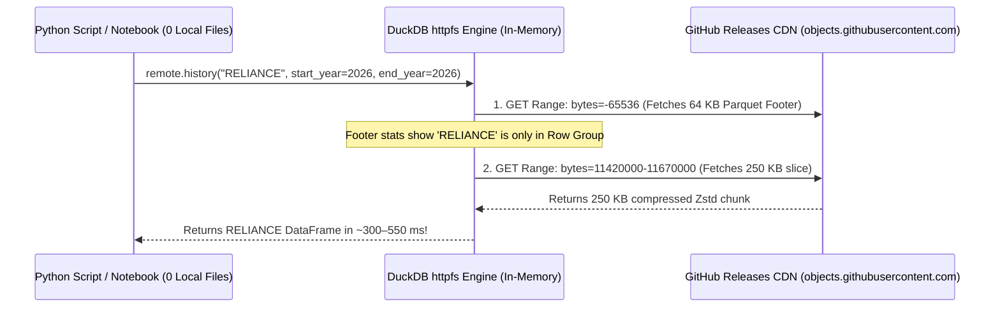

# Zero-Disk Remote Querying & Storage Optimization (`RemoteLakeClient`)

The **Zero-Disk Remote Querying Engine** (`datalake.remote`) allows users to query Parquet datasets hosted on GitHub Releases, Hugging Face, or Cloudflare R2 **directly over HTTPS with 0 MB downloaded to local disk**.

It achieves **~300–550 ms query latency** by pairing DuckDB's `httpfs` HTTP Byte-Range requests (`Range: bytes=...`) with fine-grained Parquet row-group pruning.

---

## 1. How It Works: HTTP Range Requests & `row_group_size=10_000`

### The Problem with Default Parquet Layouts
Under the default `pandas.to_parquet()` behavior (`row_group_size = 1,000,000`), all ~650,000 rows (16 MB) of an annual Indian equity partition sit in **1 giant row group**. Even with HTTP Range requests, a query for a single stock is forced to download the entire 16 MB column chunk.

### The Optimized Layout
By ensuring:
1. Data is sorted by `["Symbol", "Date"]`
2. Parquet files are written with `row_group_size = 10_000`

Each 16 MB file is split into **~65 discrete row groups (~250 KB each, ~40 stocks per group)**. The min/max stats for `Symbol` in each row group are written into the Parquet footer:

- **Bandwidth per query:** Drops from **16,000 KB $\to$ ~250 KB (98.5% less data transferred!)**.
- **Cold latency:** ~300–550 ms.
- **Warm repeat queries:** ~120–220 ms (footer cached in RAM).



---

## 2. Latency & Bandwidth Comparison

| Query Type | Local Synced Mode (`datalake pull`) | Network Byte-Range Mode (`RemoteLakeClient`, 0 Disk) | Naive Full-File Download |
| :--- | :--- | :--- | :--- |
| **Disk Space Required** | ~400 MB – 2 GB | **0 MB** | **0 MB** |
| **1-Year Stock OHLCV (`2026`)** | **1.5 – 4 ms** | **~300 – 550 ms** *(~310 KB transferred)* | ~2,500 ms *(16 MB transferred)* |
| **1-Year Warm Repeat (Same Session)** | **< 1 ms** | **~120 – 220 ms** *(Footer cached in RAM)* | ~2,200 ms |
| **5-Year Stock OHLCV (`2022–2026`)** | **3 – 7 ms** | **~600 – 950 ms** *(~1.2 MB transferred)* | ~9,000 ms *(80 MB transferred)* |
| **XBRL Financials / Shareholding** | **1 – 2 ms** | **~220 – 400 ms** *(~150 KB transferred)* | ~600 ms |
| **Full Market Screener (2,600 Stocks)** | **10 – 25 ms** | **~1.5 – 2.5 sec** *(Reads `Close` & `DeliveryPct`)* | ~2.5 sec |

---

## 3. Quickstart

```python
from datalake.remote import RemoteLakeClient

# Connect directly to your GitHub Releases release without downloading any files
remote = RemoteLakeClient(repo="your-username/bfinance-datalake", tag="datalake-latest")

# 1. Stream daily OHLCV + Delivery for RELIANCE (2024 to 2026) in ~350 ms
df_ohlcv = remote.history("RELIANCE", start_year=2024, end_year=2026)

# 2. Stream Ind-AS XBRL Quarterly Financials in ~250 ms
df_fin = remote.financials("RELIANCE", period_type="Quarterly")

# 3. Stream quarterly Promoter & Public Shareholding in ~250 ms
df_shp = remote.shareholding("RELIANCE")

# 4. Stream an EOD Option Chain partition in ~400 ms
df_fo = remote.option_chain("NIFTY", year=2026, month=10, trade_date="2026-10-30")

# 5. Run arbitrary remote SQL joins directly over HTTPS
df_sql = remote.sql("""
    SELECT Symbol, Date, Close, DeliveryPct
    FROM read_parquet('https://github.com/your-username/bfinance-datalake/releases/download/datalake-latest/equities__nse_cm_2026.parquet')
    WHERE Symbol = 'TCS'
    ORDER BY Date DESC
    LIMIT 10
""")
```

---

## 4. API Reference: `RemoteLakeClient`

### Constructor
```python
RemoteLakeClient(
    repo: str,
    tag: str = "datalake-latest",
    token: str | None = None,
    load_httpfs: bool = True,
)
```
- `repo`: GitHub repository path (e.g., `'your-username/bfinance-datalake'`).
- `tag`: Target GitHub Release tag (defaults to `'datalake-latest'`).
- `token`: Optional GitHub personal access token (or auto-read from `GITHUB_TOKEN` / `GH_TOKEN`).
- `load_httpfs`: Whether to initialize DuckDB's `httpfs` extension (defaults to `True`).

### Methods
- **`history(symbol: str, start_year: int = 2024, end_year: int = 2026, exchange: str = "NSE") -> pd.DataFrame`**  
  Streams daily price, volume, and delivery data for `symbol` across the year range using predicate pushdown.
- **`financials(symbol: str, period_type: str = "Quarterly") -> pd.DataFrame`**  
  Streams Ind-AS XBRL financials (`PeriodType='Quarterly'` or `'Annual'`).
- **`shareholding(symbol: str) -> pd.DataFrame`**  
  Streams promoter, institutional, and public shareholding history.
- **`option_chain(symbol: str, year: int, month: int, trade_date: str | date | None = None) -> pd.DataFrame`**  
  Streams contracts from the monthly derivatives partition (`nse_fo_YYYY_MM.parquet`).
- **`sql(query: str, params: list | None = None) -> pd.DataFrame`**  
  Executes arbitrary SQL queries over remote HTTPS Parquet URLs.

---

## 5. Architectural Comparison: Mode 1 vs. Mode 2

| Feature | Mode 1: `RemoteLakeClient` | Mode 2: `UnifiedLakeEngine.from_github` |
| :--- | :--- | :--- |
| **Target Environments** | Google Colab, AWS Lambda, Streamlit, ephemeral VMs | Local developer machines, dedicated research workstations |
| **Local Disk Required** | **0 MB** | ~400 MB to 2 GB |
| **Setup Overhead** | Instant (no sync step) | ~1.5s delta sync on startup |
| **Query Latency** | 300 – 550 ms per stock | **1 – 5 ms per stock** |
| **Network Requirement** | Requires active internet per query | Offline-ready once synced |
| **Best For** | Quick ad-hoc checks, serverless microservices | Multi-year backtesting, portfolio simulations, screener joins |
